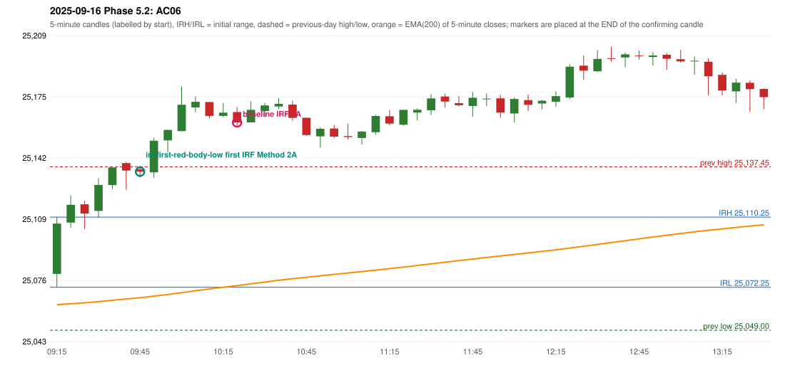

# 2025-09-16 - Phase 5.2 original versus corrected signals

> Signal-level comparison only: no controller, no fills, no P&L. Candidates are NOT approved rules.

## AC06 (PDF page 2) - topic `ORB_MISSING`

> IRF is taken, which is wrong. | ORB should take place in this condition[s]

* Original automated trade: IRF Method 2A signal 10:25; entry candle OHLC 25167.1/25169.9/25158.95/25161.45; EMA200 at that candle 25073.15; prev_high=25137.45; prev_low=25049.0; prev_close=25069.2; open=25079.5; IRH=25110.25; IRL=25072.25
* Expected (author): ORB | not stated
* Current entry conditions: Methods 1 / 2 / gap setup as encoded (Method 2 inner level and trendline are research variants); strength profile MODERATE (body >= 60%, opposite wick <= 20%) with a conditional pin bar
* Phase 5.2: audit only: the first failing rule per date; no priority override and no threshold change
* Evidence: cause LEVEL_CONSTRUCTION (no previous-day level broken; Method 2 inner level undefined in the source); first candle GREEN body 71.7%; first failing (colour direction): Method 1: NO_SETUP: first candle did not break and close beyond the previous-day high 25137.45; Method 2: NO_SETUP: first candle did not break and close beyond the inner level 25,114.20; Gap/200DMA: NO_SETUP: the gap did not push price through the 200 average
* Explicit or ambiguous: explicit complaint; cause not a single rule; resolved by Phase 5.2: EXPLAINED (cause identified); not changed; remaining decision: O8 (ORB inner level, trendline, strength profile, trend filter)

### Signal changes under the candidate configurations (this date)

| config | strategy | method | change | baseline | candidate | rule cause |
|---|---|---|---|---|---|---|
| phase52-cand-irf-first-red-low | IRF | Method 2A | REMOVED | 10:25 |  | IRF 2A candidate: support = LOW of the first red candle (level definit |
| phase52-cand-irf-first-red-low | IRF | Method 2A | REMOVED | 13:15 |  | IRF 2A candidate: support = LOW of the first red candle (level definit |
| phase52-cand-irf-first-red-low | IRF | Method 2B | REMOVED | 10:45 |  | IRF 2A candidate: support = LOW of the first red candle (level definit |
| phase52-cand-irf-first-red-low | IRF | Method 2B | REMOVED | 14:10 |  | IRF 2A candidate: support = LOW of the first red candle (level definit |
| phase52-cand-irf-first-red-low | IRF | Method 2B | REMOVED | 15:00 |  | IRF 2A candidate: support = LOW of the first red candle (level definit |
| phase52-cand-irf-first-red-body-low | IRF | Method 2A | TIME_SHIFTED_EARLIER | 10:25 | 09:50 | IRF 2A candidate: support = BODY LOW of the first red candle (level de |
| phase52-cand-irf-first-red-body-low | IRF | Method 2A | TIME_SHIFTED_EARLIER | 13:15 | 10:25 | IRF 2A candidate: support = BODY LOW of the first red candle (level de |
| phase52-cand-irf-first-red-body-low | IRF | Method 2A | ADDED |  | 11:45 | IRF 2A candidate: support = BODY LOW of the first red candle (level de |
| phase52-cand-irf-first-red-body-low | IRF | Method 2A | ADDED |  | 13:55 | IRF 2A candidate: support = BODY LOW of the first red candle (level de |
| phase52-cand-irf-first-red-body-low | IRF | Method 2B | TIME_SHIFTED_EARLIER | 14:10 | 13:35 | IRF 2A candidate: support = BODY LOW of the first red candle (level de |
| phase52-cand-irf-first-red-body-low | IRF | Method 2B | REMOVED | 15:00 |  | IRF 2A candidate: support = BODY LOW of the first red candle (level de |

