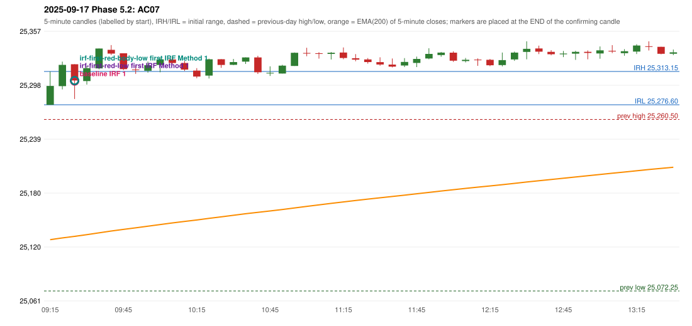

# 2025-09-17 - Phase 5.2 original versus corrected signals

> Signal-level comparison only: no controller, no fills, no P&L. Candidates are NOT approved rules.

## AC07 (PDF page 2) - topic `IRF_ENTRY_BODY (not in the call)`

> IRF should be taken after 5 candles at 6th candle, because the entry candle body is 40% Wick is 60%. | entry should be activated here. | This should be ignored.

* Original automated trade: IRF Method 1 signal 09:30; entry candle OHLC 25321.05/25321.05/25282.95/25303.2; EMA200 at that candle 25132.19; prev_high=25260.5; prev_low=25072.25; prev_close=25239.1; open=25276.6; IRH=25313.15; IRL=25276.6
* Expected (author): IRF (later candle) | later (the 6th candle instead of an earlier one)
* Current entry conditions: no entry-candle body test for IRF
* Phase 5.2: not addressed by the call; remains an owner decision
* Evidence: 
* Explicit or ambiguous: n/a; resolved by Phase 5.2: NO; remaining decision: O5 (body threshold)

### Signal changes under the candidate configurations (this date)

| config | strategy | method | change | baseline | candidate | rule cause |
|---|---|---|---|---|---|---|
| phase52-cand-irf-first-red-low | IRF | Method 2A | TIME_SHIFTED_EARLIER | 10:20 | 09:50 | IRF 2A candidate: support = LOW of the first red candle (level definit |
| phase52-cand-irf-first-red-low | IRF | Method 2A | ADDED |  | 11:20 | IRF 2A candidate: support = LOW of the first red candle (level definit |
| phase52-cand-irf-first-red-low | IRF | Method 2B | ANNOTATION_ONLY | 11:20 | 11:20 | IRF 2A candidate: support = LOW of the first red candle (level definit |
| phase52-cand-irf-first-red-body-low | IRF | Method 2A | TIME_SHIFTED_EARLIER | 10:20 | 09:50 | IRF 2A candidate: support = BODY LOW of the first red candle (level de |
| phase52-cand-irf-first-red-body-low | IRF | Method 2A | ADDED |  | 11:10 | IRF 2A candidate: support = BODY LOW of the first red candle (level de |
| phase52-cand-irf-first-red-body-low | IRF | Method 2A | ADDED |  | 11:25 | IRF 2A candidate: support = BODY LOW of the first red candle (level de |
| phase52-cand-irf-first-red-body-low | IRF | Method 2B | TIME_SHIFTED_LATER | 11:20 | 12:05 | IRF 2A candidate: support = BODY LOW of the first red candle (level de |

