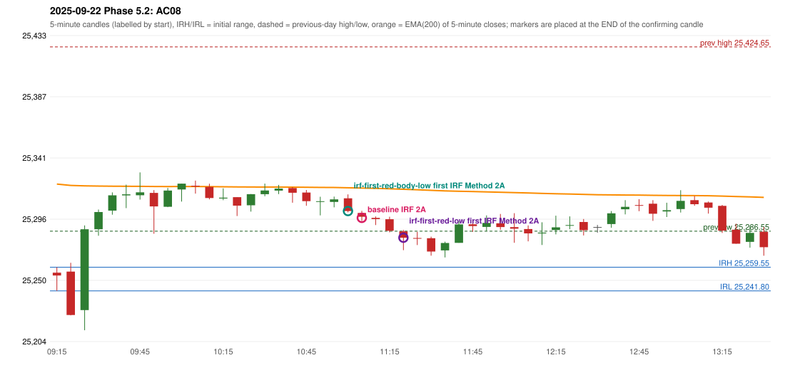

# 2025-09-22 - Phase 5.2 original versus corrected signals

> Signal-level comparison only: no controller, no fills, no P&L. Candidates are NOT approved rules.

## AC08 (PDF page 2) - topic `IRF_FIRST_RED_CANDLE`

> Entry should have activated earlier, marking first red candles Support/Resista[nce]

* Original automated trade: IRF Method 2A signal 11:10; entry candle OHLC 25300.2/25301.8/25294.15/25297.4; EMA200 at that candle 25318.88; prev_high=25424.65; prev_low=25286.55; prev_close=25327.05; open=25255.45; IRH=25259.55; IRL=25241.8
* Expected (author): IRF (earlier entry) | earlier
* Current entry conditions: Method 2A: a candle closes below the swing-low fractal support left by the extension (SWING_K1) after a red candle has formed; Method 2B: a red candle closes back below the first push top after trading above it
* Phase 5.2: candidate (not active): Method 2A support = first red candle's LOW or BODY LOW; first red candle never replaced by a later one
* Evidence: old reference support 25298.4 (candle 10:50); first red candle 09:50 OHLC 25315.25/25317.35/25284.65/25305.1; candidate LOW: later (11:10 -> 11:25 Method 2A); candidate BODY_LOW: earlier (11:10 -> 11:05 Method 2A)
* Explicit or ambiguous: ambiguous (level); resolved by Phase 5.2: NO - candidate only; level and method scope unresolved; remaining decision: O4 (level definition: low / body low / local support; scope 2A only or also 2B / Method 3)

### Signal changes under the candidate configurations (this date)

| config | strategy | method | change | baseline | candidate | rule cause |
|---|---|---|---|---|---|---|
| phase52-cand-irf-first-red-low | IRF | Method 2A | TIME_SHIFTED_LATER | 11:10 | 11:25 | IRF 2A candidate: support = LOW of the first red candle (level definit |
| phase52-cand-irf-first-red-low | IRF | Method 2A | TIME_SHIFTED_EARLIER | 14:00 | 12:10 | IRF 2A candidate: support = LOW of the first red candle (level definit |
| phase52-cand-irf-first-red-low | IRF | Method 2B | TIME_SHIFTED_LATER | 12:55 | 13:20 | IRF 2A candidate: support = LOW of the first red candle (level definit |
| phase52-cand-irf-first-red-low | IRF | Method 2B | ADDED |  | 13:55 | IRF 2A candidate: support = LOW of the first red candle (level definit |
| phase52-cand-irf-first-red-body-low | IRF | Method 2A | TIME_SHIFTED_EARLIER | 11:10 | 11:05 | IRF 2A candidate: support = BODY LOW of the first red candle (level de |
| phase52-cand-irf-first-red-body-low | IRF | Method 2A | REMOVED | 14:00 |  | IRF 2A candidate: support = BODY LOW of the first red candle (level de |
| phase52-cand-irf-first-red-body-low | IRF | Method 2B | TIME_SHIFTED_LATER | 12:55 | 13:10 | IRF 2A candidate: support = BODY LOW of the first red candle (level de |
| phase52-cand-irf-first-red-body-low | IRF | Method 2B | ADDED |  | 13:55 | IRF 2A candidate: support = BODY LOW of the first red candle (level de |

