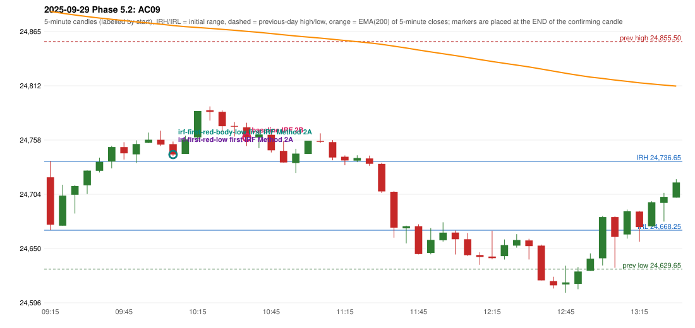

# 2025-09-29 - Phase 5.2 original versus corrected signals

> Signal-level comparison only: no controller, no fills, no P&L. Candidates are NOT approved rules.

## AC09 (PDF page 2) - topic `IRF_FIRST_RED_CANDLE`

> Late entry, red candle should be marked, 1st red candle.

* Original automated trade: IRF Method 2B signal 10:40; entry candle OHLC 24770.45/24774.9/24751.8/24760.5; EMA200 at that candle 24865.65; prev_high=24855.5; prev_low=24629.65; prev_close=24654.7; open=24720.8; IRH=24736.65; IRL=24668.25
* Expected (author): IRF (earlier entry) | earlier
* Current entry conditions: Method 2A: a candle closes below the swing-low fractal support left by the extension (SWING_K1) after a red candle has formed; Method 2B: a red candle closes back below the first push top after trading above it
* Phase 5.2: candidate (not active): Method 2A support = first red candle's LOW or BODY LOW; first red candle never replaced by a later one
* Evidence: old reference resistance 24767.05 (candle 10:00); first red candle 10:00 OHLC 24758.0/24767.05/24751.85/24753.15; candidate LOW: earlier (10:40 -> 10:10 Method 2A); candidate BODY_LOW: earlier (10:40 -> 10:10 Method 2A)
* Explicit or ambiguous: ambiguous (level); resolved by Phase 5.2: NO - candidate only; level and method scope unresolved; remaining decision: O4 (level definition: low / body low / local support; scope 2A only or also 2B / Method 3)

### Signal changes under the candidate configurations (this date)

| config | strategy | method | change | baseline | candidate | rule cause |
|---|---|---|---|---|---|---|
| phase52-cand-irf-first-red-low | IRF | Method 2A | ADDED |  | 10:10 | IRF 2A candidate: support = LOW of the first red candle (level definit |
| phase52-cand-irf-first-red-low | IRF | Method 2A | ADDED |  | 10:30 | IRF 2A candidate: support = LOW of the first red candle (level definit |
| phase52-cand-irf-first-red-low | IRF | Method 2B | REMOVED | 10:40 |  | IRF 2A candidate: support = LOW of the first red candle (level definit |
| phase52-cand-irf-first-red-body-low | IRF | Method 2A | ADDED |  | 10:10 | IRF 2A candidate: support = BODY LOW of the first red candle (level de |
| phase52-cand-irf-first-red-body-low | IRF | Method 2A | ADDED |  | 10:30 | IRF 2A candidate: support = BODY LOW of the first red candle (level de |
| phase52-cand-irf-first-red-body-low | IRF | Method 2B | REMOVED | 10:40 |  | IRF 2A candidate: support = BODY LOW of the first red candle (level de |

