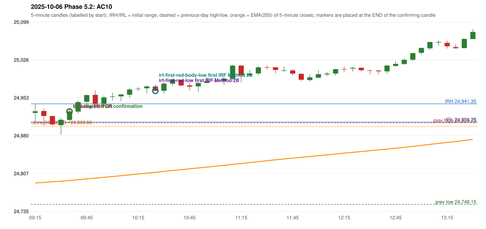

# 2025-10-06 - Phase 5.2 original versus corrected signals

> Signal-level comparison only: no controller, no fills, no P&L. Candidates are NOT approved rules.

## AC10 (PDF page 2) - topic `PDR_FIRST_ELIGIBLE`

> Long. | Enter in 1st green candle.

* Original automated trade: PDR PDR signal 09:40; entry candle OHLC 24910.45/24931.05/24906.3/24926.85; EMA200 at that candle 24794.02; prev_high=24904.75; prev_low=24748.15; prev_close=24894.25; open=24923.9; IRH=24941.35; IRL=24906.25
* Expected (author): PDR (earlier entry) | earlier (first green candle)
* Current entry conditions: zone retest, then the first later candle with GOOD_GREEN_BODY (body >= 60%, upper wick <= 20%) or LOWER_PRICE_REJECTION or HAMMER that closes strictly above the zone ceiling; the retest candle itself is not a confirmation (PDR-A07)
* Phase 5.2: already satisfied: the engine activates on the first eligible candle; the numeric thresholds and the retest-candle convention are preserved
* Evidence: zone [24896.1, 24899.8], first touch 09:20, first eligible signal 09:40, engine 09:40, verdict ENGINE_ON_FIRST_ELIGIBLE_CANDLE; author's reading: 09:30 (body 31.9%, upper wick 10.9%, lower wick 57.2%)
* Explicit or ambiguous: explicit and USER_APPROVED; resolved by Phase 5.2: PARTLY - the engine is on the first eligible candle only under the PRESERVED proposals (PDR-A07 retest convention, numeric thresholds); the author's example candle is not eligible under them; remaining decision: O6/O7 (loosen the numeric thresholds? may the retest candle be the confirmation?)

### Signal changes under the candidate configurations (this date)

| config | strategy | method | change | baseline | candidate | rule cause |
|---|---|---|---|---|---|---|
| phase52-cand-irf-first-red-low | IRF | Method 2A | TIME_SHIFTED_EARLIER | 11:50 | 10:50 | IRF 2A candidate: support = LOW of the first red candle (level definit |
| phase52-cand-irf-first-red-low | IRF | Method 2A | ADDED |  | 14:50 | IRF 2A candidate: support = LOW of the first red candle (level definit |
| phase52-cand-irf-first-red-low | IRF | Method 2B | TIME_SHIFTED_LATER | 11:05 | 11:55 | IRF 2A candidate: support = LOW of the first red candle (level definit |
| phase52-cand-irf-first-red-low | IRF | Method 2B | ANNOTATION_ONLY | 14:50 | 14:50 | IRF 2A candidate: support = LOW of the first red candle (level definit |
| phase52-cand-irf-first-red-body-low | IRF | Method 2A | TIME_SHIFTED_EARLIER | 11:50 | 10:50 | IRF 2A candidate: support = BODY LOW of the first red candle (level de |
| phase52-cand-irf-first-red-body-low | IRF | Method 2A | TIME_SHIFTED_EARLIER | 14:30 | 12:30 | IRF 2A candidate: support = BODY LOW of the first red candle (level de |
| phase52-cand-irf-first-red-body-low | IRF | Method 2A | ADDED |  | 13:25 | IRF 2A candidate: support = BODY LOW of the first red candle (level de |
| phase52-cand-irf-first-red-body-low | IRF | Method 2A | ADDED |  | 13:50 | IRF 2A candidate: support = BODY LOW of the first red candle (level de |
| phase52-cand-irf-first-red-body-low | IRF | Method 2A | ADDED |  | 14:15 | IRF 2A candidate: support = BODY LOW of the first red candle (level de |
| phase52-cand-irf-first-red-body-low | IRF | Method 2B | TIME_SHIFTED_LATER | 11:05 | 11:55 | IRF 2A candidate: support = BODY LOW of the first red candle (level de |
| phase52-cand-irf-first-red-body-low | IRF | Method 2B | ANNOTATION_ONLY | 12:30 | 12:30 | IRF 2A candidate: support = BODY LOW of the first red candle (level de |
| phase52-cand-irf-first-red-body-low | IRF | Method 2B | TIME_SHIFTED_LATER | 13:50 | 14:50 | IRF 2A candidate: support = BODY LOW of the first red candle (level de |
| phase52-cand-irf-first-red-body-low | IRF | Method 2B | REMOVED | 14:50 |  | IRF 2A candidate: support = BODY LOW of the first red candle (level de |

