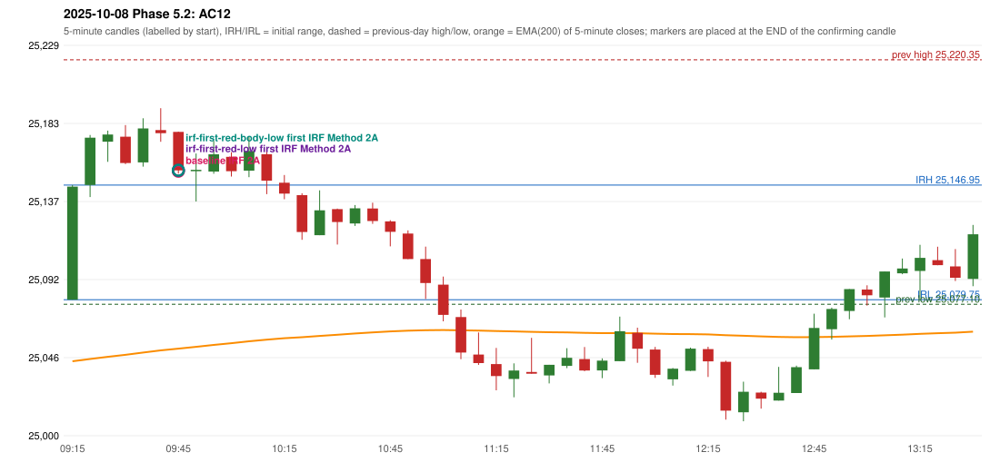

# 2025-10-08 - Phase 5.2 original versus corrected signals

> Signal-level comparison only: no controller, no fills, no P&L. Candidates are NOT approved rules.

## AC12 (PDF page 3) - topic `ORB_MISSING`

> This should be an ORB trade, but is shown as IRF. | ORB should activate, Instead IRF is activated.

* Original automated trade: IRF Method 2A signal 09:50; entry candle OHLC 25178.15/25178.3/25153.7/25155.6; EMA200 at that candle 25051.11; prev_high=25220.35; prev_low=25077.1; prev_close=25108.3; open=25079.75; IRH=25146.95; IRL=25079.75
* Expected (author): ORB | not stated
* Current entry conditions: Methods 1 / 2 / gap setup as encoded (Method 2 inner level and trendline are research variants); strength profile MODERATE (body >= 60%, opposite wick <= 20%) with a conditional pin bar
* Phase 5.2: audit only: the first failing rule per date; no priority override and no threshold change
* Evidence: cause LEVEL_CONSTRUCTION (no previous-day level broken; Method 2 inner level undefined in the source); first candle GREEN body 98.7%; first failing (colour direction): Method 1: NO_SETUP: first candle did not break and close beyond the previous-day high 25220.35; Method 2: NO_SETUP: first candle did not break and close beyond the inner level 25,167.25; Gap/200DMA: NO_SETUP: no gap in this direction
* Explicit or ambiguous: explicit complaint; cause not a single rule; resolved by Phase 5.2: EXPLAINED (cause identified); not changed; remaining decision: O8 (ORB inner level, trendline, strength profile, trend filter)

### Signal changes under the candidate configurations (this date)

No confirmed-signal difference under any candidate on this date.

