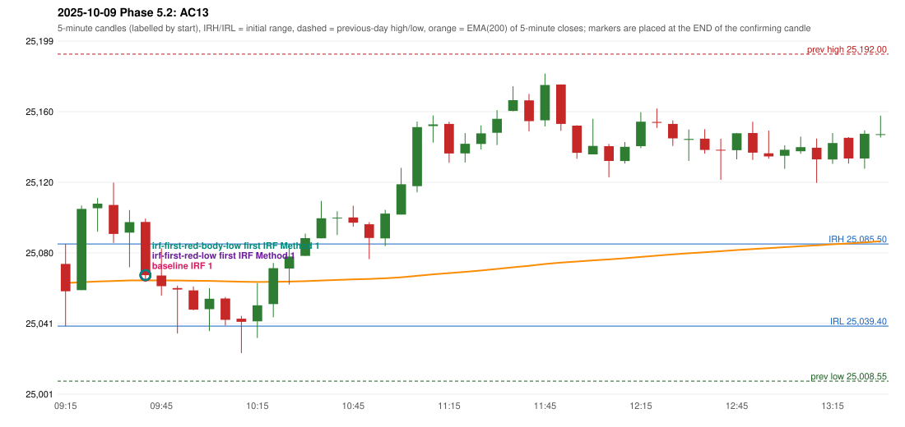

# 2025-10-09 - Phase 5.2 original versus corrected signals

> Signal-level comparison only: no controller, no fills, no P&L. Candidates are NOT approved rules.

## AC13 (PDF page 3) - topic `IRF_EMA_28`

> Wait for EMA. | The candle should close below EMA when the space btn. the entry candle is less than 27. | Wait. | 200 EMA [5 min TF] | Entry.

* Original automated trade: IRF Method 1 signal 09:45; entry candle OHLC 25097.85/25099.7/25064.25/25068.0; EMA200 at that candle 25065.07; prev_high=25192.0; prev_low=25008.55; prev_close=25046.15; open=25074.3; IRH=25085.5; IRL=25039.4
* Expected (author): IRF (later entry) | later (wait for the EMA break)
* Current entry conditions: no EMA condition exists in the IRF guide or the engine
* Phase 5.2: diagnostics only: 28-point reading and inequality not established
* Evidence: close_minus_ema=2.92640380451121; entry_minus_ema=2.7264038045104826; ema_between_entry_and_t1=True; ema_minus_t1=24.273596195489517; E1_close_gap_below_ema_28=True; E2_entry_gap_below_ema_28=True
* Explicit or ambiguous: ambiguous (measure, inequality, scope; 28 vs the handwritten 27); resolved by Phase 5.2: NO - diagnostics only; remaining decision: O2 (distance measure, inequality, skip vs wait, scope, 27 vs 28)

### Signal changes under the candidate configurations (this date)

| config | strategy | method | change | baseline | candidate | rule cause |
|---|---|---|---|---|---|---|
| phase52-cand-irf-first-red-low | IRF | Method 1 | ANNOTATION_ONLY | 09:45 | 09:45 | IRF 2A candidate: support = LOW of the first red candle (level definit |
| phase52-cand-irf-first-red-low | IRF | Method 2A | TIME_SHIFTED_EARLIER | 12:00 | 09:45 | IRF 2A candidate: support = LOW of the first red candle (level definit |
| phase52-cand-irf-first-red-low | IRF | Method 2A | TIME_SHIFTED_EARLIER | 14:15 | 10:55 | IRF 2A candidate: support = LOW of the first red candle (level definit |
| phase52-cand-irf-first-red-low | IRF | Method 2A | ADDED |  | 12:00 | IRF 2A candidate: support = LOW of the first red candle (level definit |
| phase52-cand-irf-first-red-low | IRF | Method 2A | ADDED |  | 14:15 | IRF 2A candidate: support = LOW of the first red candle (level definit |
| phase52-cand-irf-first-red-low | IRF | Method 2A | ADDED |  | 15:30 | IRF 2A candidate: support = LOW of the first red candle (level definit |
| phase52-cand-irf-first-red-low | IRF | Method 2B | TIME_SHIFTED_EARLIER | 12:25 | 11:45 | IRF 2A candidate: support = LOW of the first red candle (level definit |
| phase52-cand-irf-first-red-low | IRF | Method 2B | TIME_SHIFTED_EARLIER | 14:15 | 12:25 | IRF 2A candidate: support = LOW of the first red candle (level definit |
| phase52-cand-irf-first-red-low | IRF | Method 2B | ADDED |  | 14:15 | IRF 2A candidate: support = LOW of the first red candle (level definit |
| phase52-cand-irf-first-red-body-low | IRF | Method 1 | ANNOTATION_ONLY | 09:45 | 09:45 | IRF 2A candidate: support = BODY LOW of the first red candle (level de |
| phase52-cand-irf-first-red-body-low | IRF | Method 2A | TIME_SHIFTED_EARLIER | 12:00 | 09:45 | IRF 2A candidate: support = BODY LOW of the first red candle (level de |
| phase52-cand-irf-first-red-body-low | IRF | Method 2A | TIME_SHIFTED_EARLIER | 14:15 | 10:55 | IRF 2A candidate: support = BODY LOW of the first red candle (level de |
| phase52-cand-irf-first-red-body-low | IRF | Method 2A | ADDED |  | 12:00 | IRF 2A candidate: support = BODY LOW of the first red candle (level de |
| phase52-cand-irf-first-red-body-low | IRF | Method 2A | ADDED |  | 14:15 | IRF 2A candidate: support = BODY LOW of the first red candle (level de |
| phase52-cand-irf-first-red-body-low | IRF | Method 2A | ADDED |  | 15:30 | IRF 2A candidate: support = BODY LOW of the first red candle (level de |
| phase52-cand-irf-first-red-body-low | IRF | Method 2B | TIME_SHIFTED_EARLIER | 12:25 | 11:45 | IRF 2A candidate: support = BODY LOW of the first red candle (level de |
| phase52-cand-irf-first-red-body-low | IRF | Method 2B | TIME_SHIFTED_EARLIER | 14:15 | 12:25 | IRF 2A candidate: support = BODY LOW of the first red candle (level de |
| phase52-cand-irf-first-red-body-low | IRF | Method 2B | ADDED |  | 14:15 | IRF 2A candidate: support = BODY LOW of the first red candle (level de |

