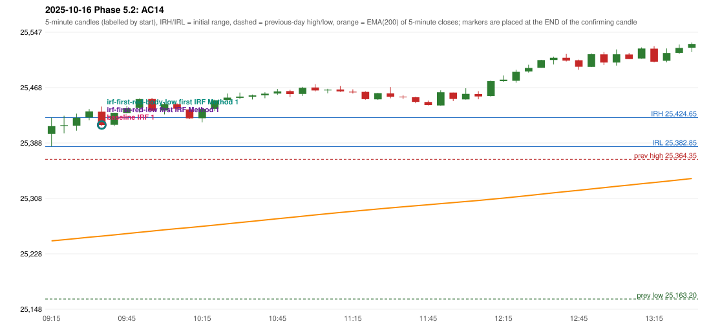

# 2025-10-16 - Phase 5.2 original versus corrected signals

> Signal-level comparison only: no controller, no fills, no P&L. Candidates are NOT approved rules.

## AC14 (PDF page 3) - topic `ORB_MISSING`

> ORB should have activated, instead IRF is activated.

* Original automated trade: IRF Method 1 signal 09:40; entry candle OHLC 25433.0/25440.35/25412.55/25413.8; EMA200 at that candle 25253.75; prev_high=25364.35; prev_low=25163.2; prev_close=25323.55; open=25401.0; IRH=25424.65; IRL=25382.85
* Expected (author): ORB | not stated
* Current entry conditions: Methods 1 / 2 / gap setup as encoded (Method 2 inner level and trendline are research variants); strength profile MODERATE (body >= 60%, opposite wick <= 20%) with a conditional pin bar
* Phase 5.2: audit only: the first failing rule per date; no priority override and no threshold change
* Evidence: cause STRONG_CANDLE_THRESHOLD; first candle GREEN body 26.7%; first failing (colour direction): Method 1: CANDLE_QUALITY(not a strong body / wick too large); Method 2: TRENDLINE_NOT_SUPPORTIVE; Gap/200DMA: NO_SETUP: the gap did not push price through the 200 average
* Explicit or ambiguous: explicit complaint; cause not a single rule; resolved by Phase 5.2: EXPLAINED (cause identified); not changed; remaining decision: O8 (ORB inner level, trendline, strength profile, trend filter)

### Signal changes under the candidate configurations (this date)

| config | strategy | method | change | baseline | candidate | rule cause |
|---|---|---|---|---|---|---|
| phase52-cand-irf-first-red-low | IRF | Method 2A | TIME_SHIFTED_EARLIER | 11:25 | 11:20 | IRF 2A candidate: support = LOW of the first red candle (level definit |
| phase52-cand-irf-first-red-low | IRF | Method 2A | TIME_SHIFTED_EARLIER | 15:15 | 12:50 | IRF 2A candidate: support = LOW of the first red candle (level definit |
| phase52-cand-irf-first-red-low | IRF | Method 2B | TIME_SHIFTED_LATER | 13:00 | 13:20 | IRF 2A candidate: support = LOW of the first red candle (level definit |
| phase52-cand-irf-first-red-low | IRF | Method 2B | REMOVED | 13:20 |  | IRF 2A candidate: support = LOW of the first red candle (level definit |
| phase52-cand-irf-first-red-body-low | IRF | Method 2A | TIME_SHIFTED_EARLIER | 11:25 | 11:15 | IRF 2A candidate: support = BODY LOW of the first red candle (level de |
| phase52-cand-irf-first-red-body-low | IRF | Method 2A | TIME_SHIFTED_LATER | 11:45 | 12:50 | IRF 2A candidate: support = BODY LOW of the first red candle (level de |
| phase52-cand-irf-first-red-body-low | IRF | Method 2A | REMOVED | 15:15 |  | IRF 2A candidate: support = BODY LOW of the first red candle (level de |
| phase52-cand-irf-first-red-body-low | IRF | Method 2B | TIME_SHIFTED_LATER | 12:10 | 13:20 | IRF 2A candidate: support = BODY LOW of the first red candle (level de |
| phase52-cand-irf-first-red-body-low | IRF | Method 2B | REMOVED | 13:00 |  | IRF 2A candidate: support = BODY LOW of the first red candle (level de |
| phase52-cand-irf-first-red-body-low | IRF | Method 2B | REMOVED | 13:20 |  | IRF 2A candidate: support = BODY LOW of the first red candle (level de |

