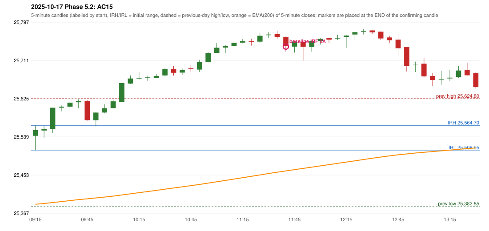

# 2025-10-17 - Phase 5.2 original versus corrected signals

> Signal-level comparison only: no controller, no fills, no P&L. Candidates are NOT approved rules.

## AC15 (PDF page 3) - topic `ORB_MISSING`

> ORB should have activated, instead IRF is activated.

* Original automated trade: IRF Method 2A signal 11:45; entry candle OHLC 25763.7/25764.7/25730.8/25743.35; EMA200 at that candle 25462.15; prev_high=25624.8; prev_low=25382.85; prev_close=25585.3; open=25541.3; IRH=25564.7; IRL=25508.95
* Expected (author): ORB | not stated
* Current entry conditions: Methods 1 / 2 / gap setup as encoded (Method 2 inner level and trendline are research variants); strength profile MODERATE (body >= 60%, opposite wick <= 20%) with a conditional pin bar
* Phase 5.2: audit only: the first failing rule per date; no priority override and no threshold change
* Evidence: cause LEVEL_CONSTRUCTION (no previous-day level broken; Method 2 inner level undefined in the source); first candle GREEN body 22.9%; first failing (colour direction): Method 1: NO_SETUP: first candle did not break and close beyond the previous-day high 25624.8; Method 2: NO_SETUP: first candle did not break and close beyond the inner level 25,576.40; Gap/200DMA: NO_SETUP: no gap in this direction
* Explicit or ambiguous: explicit complaint; cause not a single rule; resolved by Phase 5.2: EXPLAINED (cause identified); not changed; remaining decision: O8 (ORB inner level, trendline, strength profile, trend filter)

### Signal changes under the candidate configurations (this date)

| config | strategy | method | change | baseline | candidate | rule cause |
|---|---|---|---|---|---|---|
| phase52-cand-irf-first-red-low | IRF | Method 2A | REMOVED | 11:45 |  | IRF 2A candidate: support = LOW of the first red candle (level definit |
| phase52-cand-irf-first-red-low | IRF | Method 2B | REMOVED | 12:40 |  | IRF 2A candidate: support = LOW of the first red candle (level definit |
| phase52-cand-irf-first-red-body-low | IRF | Method 2A | REMOVED | 11:45 |  | IRF 2A candidate: support = BODY LOW of the first red candle (level de |
| phase52-cand-irf-first-red-body-low | IRF | Method 2B | REMOVED | 12:40 |  | IRF 2A candidate: support = BODY LOW of the first red candle (level de |

