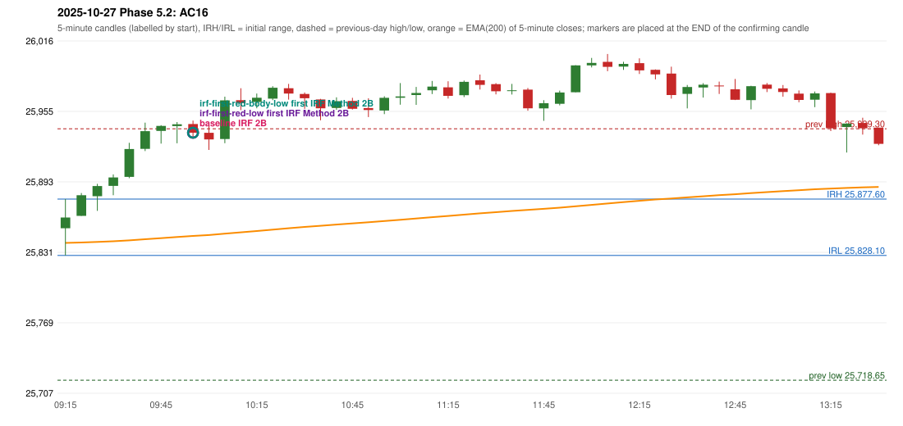

# 2025-10-27 - Phase 5.2 original versus corrected signals

> Signal-level comparison only: no controller, no fills, no P&L. Candidates are NOT approved rules.

## AC16 (PDF page 3) - topic `ORB_MISSING`

> ORB should have activated, instead IRF is activated. | IRF activation is also wrong.

* Original automated trade: IRF Method 2B signal 10:00; entry candle OHLC 25943.45/25946.45/25931.65/25935.85; EMA200 at that candle 25845.22; prev_high=25939.3; prev_low=25718.65; prev_close=25795.15; open=25851.95; IRH=25877.6; IRL=25828.1
* Expected (author): ORB | not stated
* Current entry conditions: Methods 1 / 2 / gap setup as encoded (Method 2 inner level and trendline are research variants); strength profile MODERATE (body >= 60%, opposite wick <= 20%) with a conditional pin bar
* Phase 5.2: audit only: the first failing rule per date; no priority override and no threshold change
* Evidence: cause EMA_REQUIREMENT; first candle GREEN body 19.1%; first failing (colour direction): Method 1: NO_SETUP: first candle did not break and close beyond the previous-day high 25939.3; Method 2: TREND:EMA_PREV_SESSION_CLOSE wrong side; Gap/200DMA: CANDLE_QUALITY_OR_REJECTION_WICK
* Explicit or ambiguous: explicit complaint; cause not a single rule; resolved by Phase 5.2: EXPLAINED (cause identified); not changed; remaining decision: O8 (ORB inner level, trendline, strength profile, trend filter)

### Signal changes under the candidate configurations (this date)

| config | strategy | method | change | baseline | candidate | rule cause |
|---|---|---|---|---|---|---|
| phase52-cand-irf-first-red-low | IRF | Method 2A | TIME_SHIFTED_LATER | 11:45 | 13:20 | IRF 2A candidate: support = LOW of the first red candle (level definit |
| phase52-cand-irf-first-red-low | IRF | Method 2A | REMOVED | 12:25 |  | IRF 2A candidate: support = LOW of the first red candle (level definit |
| phase52-cand-irf-first-red-low | IRF | Method 2A | REMOVED | 13:20 |  | IRF 2A candidate: support = LOW of the first red candle (level definit |
| phase52-cand-irf-first-red-low | IRF | Method 2B | TIME_SHIFTED_EARLIER | 14:15 | 13:20 | IRF 2A candidate: support = LOW of the first red candle (level definit |
| phase52-cand-irf-first-red-low | IRF | Method 2B | TIME_SHIFTED_EARLIER | 14:40 | 14:15 | IRF 2A candidate: support = LOW of the first red candle (level definit |
| phase52-cand-irf-first-red-low | IRF | Method 2B | ADDED |  | 14:40 | IRF 2A candidate: support = LOW of the first red candle (level definit |
| phase52-cand-irf-first-red-body-low | IRF | Method 2A | TIME_SHIFTED_EARLIER | 11:45 | 10:40 | IRF 2A candidate: support = BODY LOW of the first red candle (level de |
| phase52-cand-irf-first-red-body-low | IRF | Method 2A | TIME_SHIFTED_EARLIER | 12:25 | 10:55 | IRF 2A candidate: support = BODY LOW of the first red candle (level de |
| phase52-cand-irf-first-red-body-low | IRF | Method 2A | TIME_SHIFTED_EARLIER | 13:20 | 11:35 | IRF 2A candidate: support = BODY LOW of the first red candle (level de |
| phase52-cand-irf-first-red-body-low | IRF | Method 2A | ADDED |  | 12:20 | IRF 2A candidate: support = BODY LOW of the first red candle (level de |
| phase52-cand-irf-first-red-body-low | IRF | Method 2B | TIME_SHIFTED_EARLIER | 14:15 | 11:20 | IRF 2A candidate: support = BODY LOW of the first red candle (level de |
| phase52-cand-irf-first-red-body-low | IRF | Method 2B | REMOVED | 14:40 |  | IRF 2A candidate: support = BODY LOW of the first red candle (level de |

