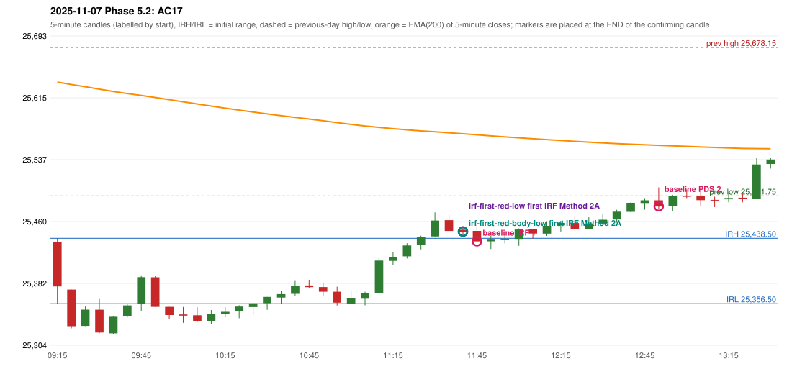

# 2025-11-07 - Phase 5.2 original versus corrected signals

> Signal-level comparison only: no controller, no fills, no P&L. Candidates are NOT approved rules.

## AC17 (PDF page 3) - topic `NOT_ADDRESSED_BY_THE_CALL`

> IRF should activate first which gives an SL. | 2nd trade should be PDS.

* Original automated trade: PDS Method 2 signal 12:55; entry candle OHLC 25486.2/25502.35/25474.75/25478.45; EMA200 at that candle 25555.19; prev_high=25678.15; prev_low=25491.75; prev_close=25509.7; open=25433.55; IRH=25438.5; IRL=25356.5
* Expected (author): IRF first (it stops out), then PDS as the 2nd trade | earlier (IRF before the PDS)
* Current entry conditions: not addressed by the call; unchanged
* Phase 5.2: none
* Evidence: 
* Explicit or ambiguous: n/a; resolved by Phase 5.2: NO - not addressed; remaining decision: see phase51 owner_approval_required.md

### Signal changes under the candidate configurations (this date)

| config | strategy | method | change | baseline | candidate | rule cause |
|---|---|---|---|---|---|---|
| phase52-cand-irf-first-red-low | IRF | Method 2A | TIME_SHIFTED_EARLIER | 14:05 | 11:45 | IRF 2A candidate: support = LOW of the first red candle (level definit |
| phase52-cand-irf-first-red-low | IRF | Method 2A | ADDED |  | 14:05 | IRF 2A candidate: support = LOW of the first red candle (level definit |
| phase52-cand-irf-first-red-low | IRF | Method 2A | ADDED |  | 14:40 | IRF 2A candidate: support = LOW of the first red candle (level definit |
| phase52-cand-irf-first-red-low | IRF | Method 2B | TIME_SHIFTED_EARLIER | 14:05 | 12:25 | IRF 2A candidate: support = LOW of the first red candle (level definit |
| phase52-cand-irf-first-red-body-low | IRF | Method 2A | TIME_SHIFTED_EARLIER | 14:05 | 11:45 | IRF 2A candidate: support = BODY LOW of the first red candle (level de |
| phase52-cand-irf-first-red-body-low | IRF | Method 2A | ADDED |  | 14:05 | IRF 2A candidate: support = BODY LOW of the first red candle (level de |
| phase52-cand-irf-first-red-body-low | IRF | Method 2A | ADDED |  | 14:40 | IRF 2A candidate: support = BODY LOW of the first red candle (level de |
| phase52-cand-irf-first-red-body-low | IRF | Method 2B | TIME_SHIFTED_EARLIER | 14:05 | 12:25 | IRF 2A candidate: support = BODY LOW of the first red candle (level de |

