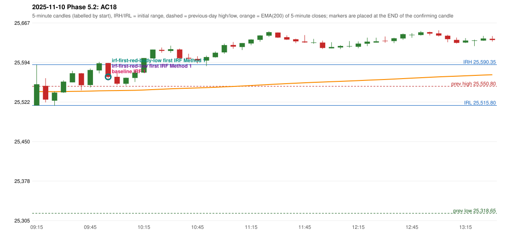

# 2025-11-10 - Phase 5.2 original versus corrected signals

> Signal-level comparison only: no controller, no fills, no P&L. Candidates are NOT approved rules.

## AC18 (PDF page 4) - topic `IRF_EMA_28`

> Should be ignored as Tgt 1 is not above EMA, tgt 1 is less than 27. | Should wait until EMA break.

* Original automated trade: IRF Method 1 signal 10:00; entry candle OHLC 25593.3/25593.65/25565.05/25568.1; EMA200 at that candle 25542.83; prev_high=25550.8; prev_low=25318.65; prev_close=25492.3; open=25515.8; IRH=25590.35; IRL=25515.8
* Expected (author): IRF (later entry, or none) | later (wait until the EMA is broken)
* Current entry conditions: no EMA condition exists in the IRF guide or the engine
* Phase 5.2: diagnostics only: 28-point reading and inequality not established
* Evidence: close_minus_ema=25.269671700712934; entry_minus_ema=25.369671700715116; ema_between_entry_and_t1=True; ema_minus_t1=1.6303282992848835; E1_close_gap_below_ema_28=True; E2_entry_gap_below_ema_28=True
* Explicit or ambiguous: ambiguous (measure, inequality, scope; 28 vs the handwritten 27); resolved by Phase 5.2: NO - diagnostics only; remaining decision: O2 (distance measure, inequality, skip vs wait, scope, 27 vs 28)

### Signal changes under the candidate configurations (this date)

| config | strategy | method | change | baseline | candidate | rule cause |
|---|---|---|---|---|---|---|
| phase52-cand-irf-first-red-low | IRF | Method 2A | ADDED |  | 10:40 | IRF 2A candidate: support = LOW of the first red candle (level definit |
| phase52-cand-irf-first-red-low | IRF | Method 2A | ADDED |  | 13:05 | IRF 2A candidate: support = LOW of the first red candle (level definit |
| phase52-cand-irf-first-red-low | IRF | Method 2B | TIME_SHIFTED_LATER | 11:10 | 11:50 | IRF 2A candidate: support = LOW of the first red candle (level definit |
| phase52-cand-irf-first-red-low | IRF | Method 2B | TIME_SHIFTED_LATER | 11:50 | 13:05 | IRF 2A candidate: support = LOW of the first red candle (level definit |
| phase52-cand-irf-first-red-low | IRF | Method 2B | REMOVED | 13:05 |  | IRF 2A candidate: support = LOW of the first red candle (level definit |
| phase52-cand-irf-first-red-body-low | IRF | Method 2A | ADDED |  | 10:40 | IRF 2A candidate: support = BODY LOW of the first red candle (level de |
| phase52-cand-irf-first-red-body-low | IRF | Method 2A | ADDED |  | 13:05 | IRF 2A candidate: support = BODY LOW of the first red candle (level de |
| phase52-cand-irf-first-red-body-low | IRF | Method 2B | TIME_SHIFTED_LATER | 11:10 | 11:50 | IRF 2A candidate: support = BODY LOW of the first red candle (level de |
| phase52-cand-irf-first-red-body-low | IRF | Method 2B | TIME_SHIFTED_LATER | 11:50 | 13:05 | IRF 2A candidate: support = BODY LOW of the first red candle (level de |
| phase52-cand-irf-first-red-body-low | IRF | Method 2B | REMOVED | 13:05 |  | IRF 2A candidate: support = BODY LOW of the first red candle (level de |

