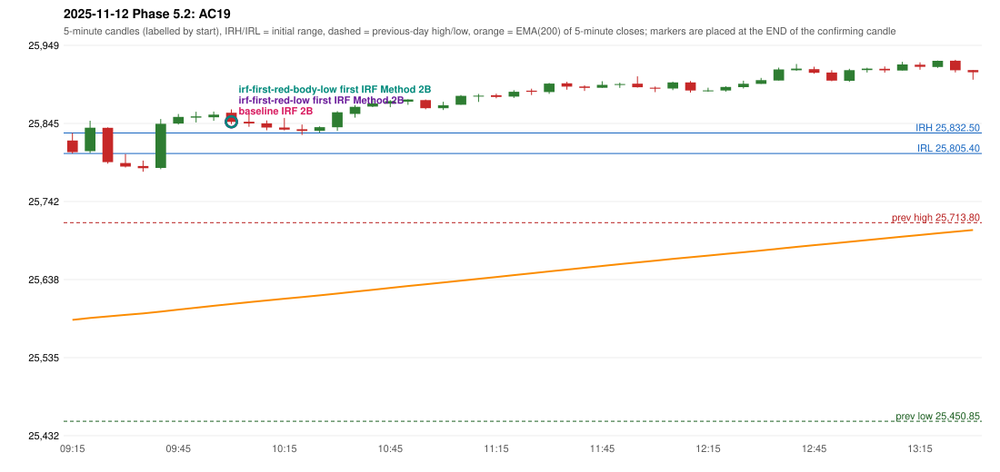

# 2025-11-12 - Phase 5.2 original versus corrected signals

> Signal-level comparison only: no controller, no fills, no P&L. Candidates are NOT approved rules.

## AC19 (PDF page 4) - topic `IRF_DAY_LOW`

> This day trading should be completely stopped as IRF is already activate[d] Ep entry is below days low.

* Original automated trade: IRF Method 2B signal 10:05; entry candle OHLC 25859.4/25863.85/25844.3/25847.3; EMA200 at that candle 25606.14; prev_high=25713.8; prev_low=25450.85; prev_close=25694.95; open=25822.6; IRH=25832.5; IRL=25805.4
* Expected (author): no trade (IRF should not have been taken at the day's low) | not at all
* Current entry conditions: no day's-low condition exists in the IRF guide or the engine
* Phase 5.2: diagnostics only: running-low readings computed at decision time; the source statement is not located
* Evidence: running_low_before_signal_candle=25781.25; entry_minus_running_low_before=66.25; t1_clearance_above_running_low=39.25; D1_entry_at_or_below_running_low=False; D2_close_below_running_low_before=False; D4_t1_beyond_running_low=False; irl=25805.4; D6_running_low_already_below_irl=True; D7_earlier_close_below_irl=True; previous_day_low=25450.85; D8_entry_below_previous_day_low=False
* Explicit or ambiguous: ambiguous (meaning); source location unverified; resolved by Phase 5.2: NO - diagnostics only; remaining decision: O3 (meaning; where in the documents)

### Signal changes under the candidate configurations (this date)

| config | strategy | method | change | baseline | candidate | rule cause |
|---|---|---|---|---|---|---|
| phase52-cand-irf-first-red-low | IRF | Method 2A | TIME_SHIFTED_LATER | 14:10 | 15:25 | IRF 2A candidate: support = LOW of the first red candle (level definit |
| phase52-cand-irf-first-red-low | IRF | Method 2B | ADDED |  | 15:25 | IRF 2A candidate: support = LOW of the first red candle (level definit |
| phase52-cand-irf-first-red-body-low | IRF | Method 2A | TIME_SHIFTED_LATER | 14:10 | 15:25 | IRF 2A candidate: support = BODY LOW of the first red candle (level de |
| phase52-cand-irf-first-red-body-low | IRF | Method 2B | ADDED |  | 15:25 | IRF 2A candidate: support = BODY LOW of the first red candle (level de |

