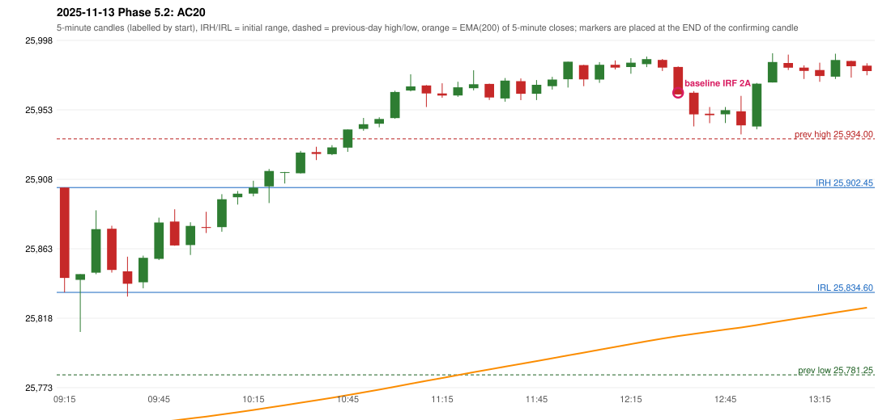

# 2025-11-13 - Phase 5.2 original versus corrected signals

> Signal-level comparison only: no controller, no fills, no P&L. Candidates are NOT approved rules.

## AC20 (PDF page 4) - topic `IRF_FIRST_RED_CANDLE`

> First red candle only should be considered.

* Original automated trade: IRF Method 2A signal 12:35; entry candle OHLC 25980.55/25980.9/25962.75/25962.75; EMA200 at that candle 25806.31; prev_high=25934.0; prev_low=25781.25; prev_close=25875.8; open=25902.45; IRH=25902.45; IRL=25834.6
* Expected (author): IRF (same strategy, correct reference candle) | not stated
* Current entry conditions: Method 2A: a candle closes below the swing-low fractal support left by the extension (SWING_K1) after a red candle has formed; Method 2B: a red candle closes back below the first push top after trading above it
* Phase 5.2: candidate (not active): Method 2A support = first red candle's LOW or BODY LOW; first red candle never replaced by a later one
* Evidence: old reference support 25976.15 (candle 12:15); first red candle 10:35 OHLC 25925.4/25928.85/25920.25/25924.2; candidate LOW: later (12:35 -> 14:05 Method 2A); candidate BODY_LOW: later (12:35 -> 14:05 Method 2A)
* Explicit or ambiguous: ambiguous (level); resolved by Phase 5.2: NO - candidate only; level and method scope unresolved; remaining decision: O4 (level definition: low / body low / local support; scope 2A only or also 2B / Method 3)

### Signal changes under the candidate configurations (this date)

| config | strategy | method | change | baseline | candidate | rule cause |
|---|---|---|---|---|---|---|
| phase52-cand-irf-first-red-low | IRF | Method 1 | ANNOTATION_ONLY | 14:55 | 14:55 | IRF 2A candidate: support = LOW of the first red candle (level definit |
| phase52-cand-irf-first-red-low | IRF | Method 2A | TIME_SHIFTED_LATER | 12:35 | 14:05 | IRF 2A candidate: support = LOW of the first red candle (level definit |
| phase52-cand-irf-first-red-low | IRF | Method 2A | ADDED |  | 14:40 | IRF 2A candidate: support = LOW of the first red candle (level definit |
| phase52-cand-irf-first-red-low | IRF | Method 2A | ADDED |  | 14:55 | IRF 2A candidate: support = LOW of the first red candle (level definit |
| phase52-cand-irf-first-red-low | IRF | Method 2B | TIME_SHIFTED_LATER | 13:50 | 14:05 | IRF 2A candidate: support = LOW of the first red candle (level definit |
| phase52-cand-irf-first-red-low | IRF | Method 2B | REMOVED | 14:50 |  | IRF 2A candidate: support = LOW of the first red candle (level definit |
| phase52-cand-irf-first-red-body-low | IRF | Method 1 | ANNOTATION_ONLY | 14:55 | 14:55 | IRF 2A candidate: support = BODY LOW of the first red candle (level de |
| phase52-cand-irf-first-red-body-low | IRF | Method 2A | TIME_SHIFTED_LATER | 12:35 | 14:05 | IRF 2A candidate: support = BODY LOW of the first red candle (level de |
| phase52-cand-irf-first-red-body-low | IRF | Method 2A | ADDED |  | 14:40 | IRF 2A candidate: support = BODY LOW of the first red candle (level de |
| phase52-cand-irf-first-red-body-low | IRF | Method 2A | ADDED |  | 14:55 | IRF 2A candidate: support = BODY LOW of the first red candle (level de |
| phase52-cand-irf-first-red-body-low | IRF | Method 2B | TIME_SHIFTED_LATER | 13:50 | 14:05 | IRF 2A candidate: support = BODY LOW of the first red candle (level de |
| phase52-cand-irf-first-red-body-low | IRF | Method 2B | REMOVED | 14:50 |  | IRF 2A candidate: support = BODY LOW of the first red candle (level de |

