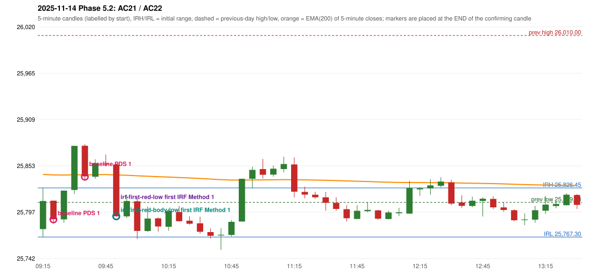

# 2025-11-14 - Phase 5.2 original versus corrected signals

> Signal-level comparison only: no controller, no fills, no P&L. Candidates are NOT approved rules.

## AC21 (PDF page 4) - topic `NOT_ADDRESSED_BY_THE_CALL`

> The IRF should be activated instead of PDS. | PDS criteria is not satisfying.

* Original automated trade: PDS Method 1 signal 09:25; entry candle OHLC 25811.1/25811.1/25783.55/25788.7; EMA200 at that candle 25842.12; prev_high=26010.0; prev_low=25809.0; prev_close=25879.15; open=25776.85; IRH=25826.45; IRL=25767.3
* Expected (author): IRF | not stated
* Current entry conditions: not addressed by the call; unchanged
* Phase 5.2: none
* Evidence: 
* Explicit or ambiguous: n/a; resolved by Phase 5.2: NO - not addressed; remaining decision: see phase51 owner_approval_required.md

## AC22 (PDF page 4) - topic `NOT_ADDRESSED_BY_THE_CALL`

> IRF should activate. | Same day 2nd trade, ig it's glitch.

* Original automated trade: PDS Method 1 signal 09:40; entry candle OHLC 25877.2/25878.95/25835.95/25840.4; EMA200 at that candle 25842.27; prev_high=26010.0; prev_low=25809.0; prev_close=25879.15; open=25776.85; IRH=25826.45; IRL=25767.3
* Expected (author): IRF | not stated
* Current entry conditions: not addressed by the call; unchanged
* Phase 5.2: none
* Evidence: 
* Explicit or ambiguous: n/a; resolved by Phase 5.2: NO - not addressed; remaining decision: see phase51 owner_approval_required.md

### Signal changes under the candidate configurations (this date)

| config | strategy | method | change | baseline | candidate | rule cause |
|---|---|---|---|---|---|---|
| phase52-cand-irf-first-red-low | IRF | Method 1 | ANNOTATION_ONLY | 09:55 | 09:55 | IRF 2A candidate: support = LOW of the first red candle (level definit |
| phase52-cand-irf-first-red-low | IRF | Method 1 | ANNOTATION_ONLY | 11:20 | 11:20 | IRF 2A candidate: support = LOW of the first red candle (level definit |
| phase52-cand-irf-first-red-low | IRF | Method 2A | TIME_SHIFTED_EARLIER | 13:05 | 09:55 | IRF 2A candidate: support = LOW of the first red candle (level definit |
| phase52-cand-irf-first-red-low | IRF | Method 2A | ADDED |  | 11:20 | IRF 2A candidate: support = LOW of the first red candle (level definit |
| phase52-cand-irf-first-red-low | IRF | Method 2A | ADDED |  | 12:40 | IRF 2A candidate: support = LOW of the first red candle (level definit |
| phase52-cand-irf-first-red-low | IRF | Method 2B | ADDED |  | 11:20 | IRF 2A candidate: support = LOW of the first red candle (level definit |
| phase52-cand-irf-first-red-body-low | IRF | Method 1 | ANNOTATION_ONLY | 09:55 | 09:55 | IRF 2A candidate: support = BODY LOW of the first red candle (level de |
| phase52-cand-irf-first-red-body-low | IRF | Method 1 | ANNOTATION_ONLY | 11:20 | 11:20 | IRF 2A candidate: support = BODY LOW of the first red candle (level de |
| phase52-cand-irf-first-red-body-low | IRF | Method 2A | TIME_SHIFTED_EARLIER | 13:05 | 09:55 | IRF 2A candidate: support = BODY LOW of the first red candle (level de |
| phase52-cand-irf-first-red-body-low | IRF | Method 2A | ADDED |  | 11:20 | IRF 2A candidate: support = BODY LOW of the first red candle (level de |
| phase52-cand-irf-first-red-body-low | IRF | Method 2A | ADDED |  | 12:40 | IRF 2A candidate: support = BODY LOW of the first red candle (level de |
| phase52-cand-irf-first-red-body-low | IRF | Method 2A | ADDED |  | 15:20 | IRF 2A candidate: support = BODY LOW of the first red candle (level de |
| phase52-cand-irf-first-red-body-low | IRF | Method 2B | ADDED |  | 11:20 | IRF 2A candidate: support = BODY LOW of the first red candle (level de |

