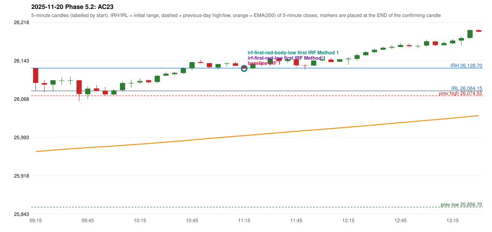

# 2025-11-20 - Phase 5.2 original versus corrected signals

> Signal-level comparison only: no controller, no fills, no P&L. Candidates are NOT approved rules.

## AC23 (PDF page 4) - topic `NOT_ADDRESSED_BY_THE_CALL`

> [crossed out:] RF should be activated + Or PDR should be activated as it Sab[?]

* Original automated trade: IRF Method 1 signal 11:20; entry candle OHLC 26133.4/26135.95/26126.95/26127.8; EMA200 at that candle 25996.62; prev_high=26074.55; prev_low=25856.7; prev_close=26052.65; open=26128.7; IRH=26128.7; IRL=26084.15
* Expected (author): (crossed out - not an active instruction) | n/a
* Current entry conditions: not addressed by the call; unchanged
* Phase 5.2: none
* Evidence: 
* Explicit or ambiguous: n/a; resolved by Phase 5.2: NO - not addressed; remaining decision: see phase51 owner_approval_required.md

### Signal changes under the candidate configurations (this date)

| config | strategy | method | change | baseline | candidate | rule cause |
|---|---|---|---|---|---|---|
| phase52-cand-irf-first-red-low | IRF | Method 1 | ANNOTATION_ONLY | 11:20 | 11:20 | IRF 2A candidate: support = LOW of the first red candle (level definit |
| phase52-cand-irf-first-red-low | IRF | Method 2A | TIME_SHIFTED_EARLIER | 14:30 | 11:20 | IRF 2A candidate: support = LOW of the first red candle (level definit |
| phase52-cand-irf-first-red-low | IRF | Method 2A | ADDED |  | 11:50 | IRF 2A candidate: support = LOW of the first red candle (level definit |
| phase52-cand-irf-first-red-low | IRF | Method 2B | REMOVED | 11:40 |  | IRF 2A candidate: support = LOW of the first red candle (level definit |
| phase52-cand-irf-first-red-body-low | IRF | Method 1 | ANNOTATION_ONLY | 11:20 | 11:20 | IRF 2A candidate: support = BODY LOW of the first red candle (level de |
| phase52-cand-irf-first-red-body-low | IRF | Method 2A | TIME_SHIFTED_EARLIER | 14:30 | 11:20 | IRF 2A candidate: support = BODY LOW of the first red candle (level de |
| phase52-cand-irf-first-red-body-low | IRF | Method 2A | ADDED |  | 11:50 | IRF 2A candidate: support = BODY LOW of the first red candle (level de |
| phase52-cand-irf-first-red-body-low | IRF | Method 2B | REMOVED | 11:40 |  | IRF 2A candidate: support = BODY LOW of the first red candle (level de |

