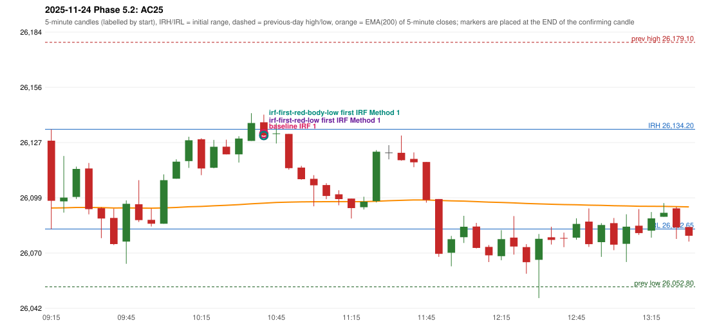

# 2025-11-24 - Phase 5.2 original versus corrected signals

> Signal-level comparison only: no controller, no fills, no P&L. Candidates are NOT approved rules.

## AC25 (PDF page 5) - topic `NOT_ADDRESSED_BY_THE_CALL`

> RF should be activated, but IRF is entered

* Original automated trade: IRF Method 1 signal 10:45; entry candle OHLC 26137.8/26141.75/26130.5/26130.95; EMA200 at that candle 26096.04; prev_high=26179.1; prev_low=26052.8; prev_close=26068.15; open=26128.3; IRH=26134.2; IRL=26082.65
* Expected (author): RF | not stated
* Current entry conditions: not addressed by the call; unchanged
* Phase 5.2: none
* Evidence: 
* Explicit or ambiguous: n/a; resolved by Phase 5.2: NO - not addressed; remaining decision: see phase51 owner_approval_required.md

### Signal changes under the candidate configurations (this date)

No confirmed-signal difference under any candidate on this date.

