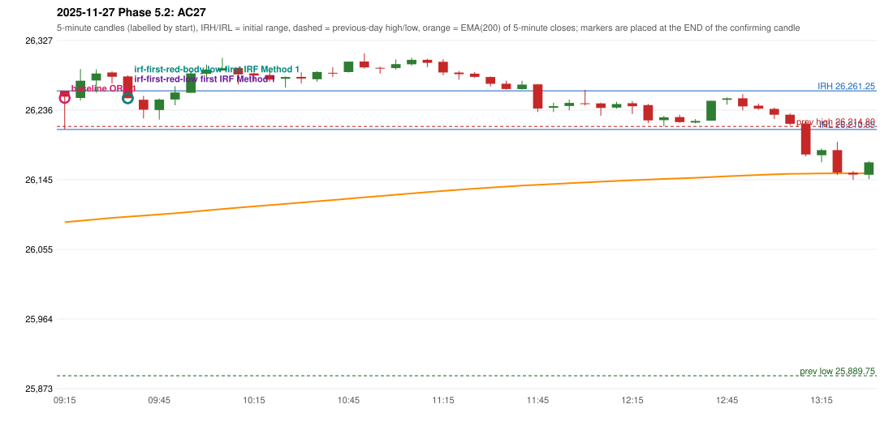

# 2025-11-27 - Phase 5.2 original versus corrected signals

> Signal-level comparison only: no controller, no fills, no P&L. Candidates are NOT approved rules.

## AC27 (PDF page 5) - topic `ORB_COLOUR`

> ORB is activated on a red candle for long side, which is wrong. ORB for long should be in green closing.

* Original automated trade: ORB Method 1 signal 09:20; entry candle OHLC 26261.25/26261.25/26210.85/26253.6; EMA200 at that candle 26089.96; prev_high=26214.8; prev_low=25889.75; prev_close=26205.3; open=26261.25; IRH=26261.25; IRL=26210.85
* Expected (author): ORB (long only on a green close) | not stated
* Current entry conditions: the pin-bar route admits a first candle of either colour
* Phase 5.2: candidate (opt-in, Phase 5.1): long needs green, short red
* Evidence: ORB colour candidate invalidates this confirmation (see before_after_signals.csv, config phase52-cand-orb-colour)
* Explicit or ambiguous: explicit for long; short is an interpretation; resolved by Phase 5.2: CANDIDATE selectable; not active; remaining decision: O1 (adopt? short mirror)

### Signal changes under the candidate configurations (this date)

| config | strategy | method | change | baseline | candidate | rule cause |
|---|---|---|---|---|---|---|
| phase52-cand-orb-colour | ORB | Method 1 | REMOVED | 09:20 |  | ORB colour candidate: first candle colour contradicts the direction (O |
| phase52-cand-irf-first-red-low | IRF | Method 2A | TIME_SHIFTED_EARLIER | 11:25 | 11:20 | IRF 2A candidate: support = LOW of the first red candle (level definit |
| phase52-cand-irf-first-red-body-low | IRF | Method 2A | TIME_SHIFTED_EARLIER | 11:25 | 11:00 | IRF 2A candidate: support = BODY LOW of the first red candle (level de |
| phase52-cand-irf-first-red-body-low | IRF | Method 2A | ADDED |  | 11:20 | IRF 2A candidate: support = BODY LOW of the first red candle (level de |

