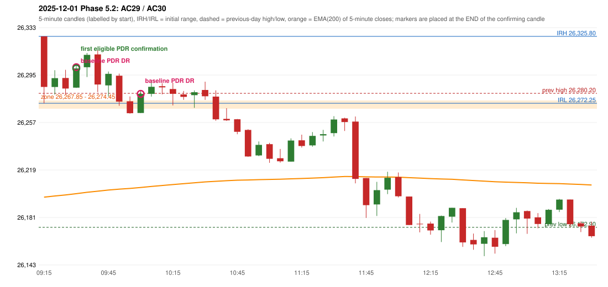

# 2025-12-01 - Phase 5.2 original versus corrected signals

> Signal-level comparison only: no controller, no fills, no P&L. Candidates are NOT approved rules.

## AC29 (PDF page 5) - topic `PDR_FIRST_ELIGIBLE`

> Early entry should take place in 1st green candle

* Original automated trade: PDR PDR signal 09:35; entry candle OHLC 26284.75/26303.95/26284.55/26300.15; EMA200 at that candle 26199.87; prev_high=26280.2; prev_low=26172.9; prev_close=26202.95; open=26325.8; IRH=26325.8; IRL=26272.25
* Expected (author): PDR (earlier entry) | earlier (first green candle)
* Current entry conditions: zone retest, then the first later candle with GOOD_GREEN_BODY (body >= 60%, upper wick <= 20%) or LOWER_PRICE_REJECTION or HAMMER that closes strictly above the zone ceiling; the retest candle itself is not a confirmation (PDR-A07)
* Phase 5.2: already satisfied: the engine activates on the first eligible candle; the numeric thresholds and the retest-candle convention are preserved
* Evidence: zone [26267.85, 26274.45], first touch 09:15, first eligible signal 09:35, engine 09:35, verdict ENGINE_ON_FIRST_ELIGIBLE_CANDLE; author's reading: 09:20 (body 36.2%, upper wick 32.6%, lower wick 31.3%)
* Explicit or ambiguous: explicit and USER_APPROVED; resolved by Phase 5.2: PARTLY - the engine is on the first eligible candle only under the PRESERVED proposals (PDR-A07 retest convention, numeric thresholds); the author's example candle is not eligible under them; remaining decision: O6/O7 (loosen the numeric thresholds? may the retest candle be the confirmation?)

## AC30 (PDF page 5) - topic `NOT_ADDRESSED_BY_THE_CALL`

> 2nd entry should be ignored.

* Original automated trade: PDR PDR signal 10:05; entry candle OHLC 26264.45/26282.15/26264.45/26279.75; EMA200 at that candle 26204.83; prev_high=26280.2; prev_low=26172.9; prev_close=26202.95; open=26325.8; IRH=26325.8; IRL=26272.25
* Expected (author): no second trade | not at all
* Current entry conditions: not addressed by the call; unchanged
* Phase 5.2: none
* Evidence: 
* Explicit or ambiguous: n/a; resolved by Phase 5.2: NO - not addressed; remaining decision: see phase51 owner_approval_required.md

### Signal changes under the candidate configurations (this date)

No confirmed-signal difference under any candidate on this date.

