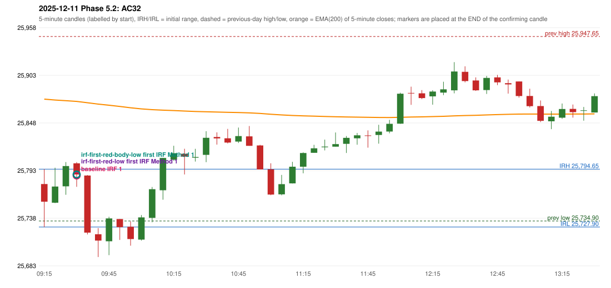

# 2025-12-11 - Phase 5.2 original versus corrected signals

> Signal-level comparison only: no controller, no fills, no P&L. Candidates are NOT approved rules.

## AC32 (PDF page 5) - topic `IRF_DAY_LOW`

> Should be ignored as candle body is less than 50%. | 2nd candle should also be ignores as it is at day's low.

* Original automated trade: IRF Method 1 signal 09:35; entry candle OHLC 25801.35/25802.75/25774.3/25788.5; EMA200 at that candle 25872.78; prev_high=25947.65; prev_low=25734.9; prev_close=25758.0; open=25777.45; IRH=25794.65; IRL=25727.9
* Expected (author): no trade (candle ignored) | not at all / later
* Current entry conditions: no day's-low condition exists in the IRF guide or the engine
* Phase 5.2: diagnostics only: running-low readings computed at decision time; the source statement is not located
* Evidence: running_low_before_signal_candle=25727.9; entry_minus_running_low_before=59.39999999999782; t1_clearance_above_running_low=32.39999999999782; D1_entry_at_or_below_running_low=False; D2_close_below_running_low_before=False; D4_t1_beyond_running_low=False; irl=25727.9; D6_running_low_already_below_irl=False; D7_earlier_close_below_irl=False; previous_day_low=25734.9; D8_entry_below_previous_day_low=False
* Explicit or ambiguous: ambiguous (meaning); source location unverified; resolved by Phase 5.2: NO - diagnostics only; remaining decision: O3 (meaning; where in the documents)

### Signal changes under the candidate configurations (this date)

| config | strategy | method | change | baseline | candidate | rule cause |
|---|---|---|---|---|---|---|
| phase52-cand-irf-first-red-low | IRF | Method 1 | ANNOTATION_ONLY | 11:00 | 11:00 | IRF 2A candidate: support = LOW of the first red candle (level definit |
| phase52-cand-irf-first-red-low | IRF | Method 2A | TIME_SHIFTED_LATER | 11:00 | 13:00 | IRF 2A candidate: support = LOW of the first red candle (level definit |
| phase52-cand-irf-first-red-low | IRF | Method 2A | TIME_SHIFTED_LATER | 13:00 | 14:40 | IRF 2A candidate: support = LOW of the first red candle (level definit |
| phase52-cand-irf-first-red-low | IRF | Method 2B | ANNOTATION_ONLY | 11:00 | 11:00 | IRF 2A candidate: support = LOW of the first red candle (level definit |
| phase52-cand-irf-first-red-low | IRF | Method 2B | REMOVED | 14:45 |  | IRF 2A candidate: support = LOW of the first red candle (level definit |
| phase52-cand-irf-first-red-body-low | IRF | Method 1 | ANNOTATION_ONLY | 11:00 | 11:00 | IRF 2A candidate: support = BODY LOW of the first red candle (level de |
| phase52-cand-irf-first-red-body-low | IRF | Method 2A | TIME_SHIFTED_EARLIER | 11:00 | 10:30 | IRF 2A candidate: support = BODY LOW of the first red candle (level de |
| phase52-cand-irf-first-red-body-low | IRF | Method 2A | TIME_SHIFTED_EARLIER | 13:00 | 10:45 | IRF 2A candidate: support = BODY LOW of the first red candle (level de |
| phase52-cand-irf-first-red-body-low | IRF | Method 2A | ADDED |  | 11:00 | IRF 2A candidate: support = BODY LOW of the first red candle (level de |
| phase52-cand-irf-first-red-body-low | IRF | Method 2A | ADDED |  | 12:15 | IRF 2A candidate: support = BODY LOW of the first red candle (level de |
| phase52-cand-irf-first-red-body-low | IRF | Method 2A | ADDED |  | 12:40 | IRF 2A candidate: support = BODY LOW of the first red candle (level de |
| phase52-cand-irf-first-red-body-low | IRF | Method 2A | ADDED |  | 12:55 | IRF 2A candidate: support = BODY LOW of the first red candle (level de |
| phase52-cand-irf-first-red-body-low | IRF | Method 2A | ADDED |  | 14:40 | IRF 2A candidate: support = BODY LOW of the first red candle (level de |
| phase52-cand-irf-first-red-body-low | IRF | Method 2B | TIME_SHIFTED_EARLIER | 11:00 | 10:45 | IRF 2A candidate: support = BODY LOW of the first red candle (level de |
| phase52-cand-irf-first-red-body-low | IRF | Method 2B | TIME_SHIFTED_LATER | 12:40 | 14:05 | IRF 2A candidate: support = BODY LOW of the first red candle (level de |
| phase52-cand-irf-first-red-body-low | IRF | Method 2B | REMOVED | 14:05 |  | IRF 2A candidate: support = BODY LOW of the first red candle (level de |
| phase52-cand-irf-first-red-body-low | IRF | Method 2B | REMOVED | 14:45 |  | IRF 2A candidate: support = BODY LOW of the first red candle (level de |

