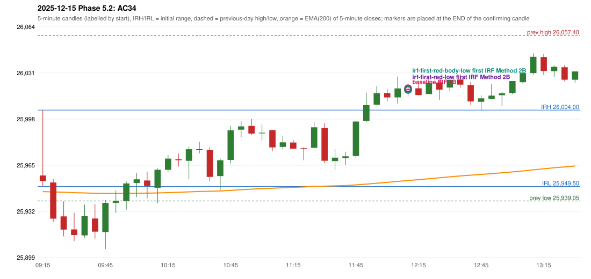

# 2025-12-15 - Phase 5.2 original versus corrected signals

> Signal-level comparison only: no controller, no fills, no P&L. Candidates are NOT approved rules.

## AC34 (PDF page 6) - topic `IRF_FIRST_RED_CANDLE`

> First red candle should be considered.

* Original automated trade: IRF Method 2B signal 12:15; entry candle OHLC 26019.25/26021.85/26013.7/26018.55; EMA200 at that candle 25953.69; prev_high=26057.4; prev_low=25939.05; prev_close=26046.95; open=25957.25; IRH=26004.0; IRL=25949.5
* Expected (author): IRF (same strategy, correct reference candle) | not stated
* Current entry conditions: Method 2A: a candle closes below the swing-low fractal support left by the extension (SWING_K1) after a red candle has formed; Method 2B: a red candle closes back below the first push top after trading above it
* Phase 5.2: candidate (not active): Method 2A support = first red candle's LOW or BODY LOW; first red candle never replaced by a later one
* Evidence: old reference resistance 26021.05 (candle 11:55); first red candle 12:00 OHLC 26016.2/26019.2/26010.15/26013.05; candidate LOW: same time and method; candidate BODY_LOW: same time and method
* Explicit or ambiguous: ambiguous (level); resolved by Phase 5.2: NO - candidate only; level and method scope unresolved; remaining decision: O4 (level definition: low / body low / local support; scope 2A only or also 2B / Method 3)

### Signal changes under the candidate configurations (this date)

| config | strategy | method | change | baseline | candidate | rule cause |
|---|---|---|---|---|---|---|
| phase52-cand-irf-first-red-low | IRF | Method 2A | TIME_SHIFTED_EARLIER | 15:30 | 13:30 | IRF 2A candidate: support = LOW of the first red candle (level definit |
| phase52-cand-irf-first-red-low | IRF | Method 2A | ADDED |  | 15:05 | IRF 2A candidate: support = LOW of the first red candle (level definit |
| phase52-cand-irf-first-red-low | IRF | Method 2B | ANNOTATION_ONLY | 13:30 | 13:30 | IRF 2A candidate: support = LOW of the first red candle (level definit |
| phase52-cand-irf-first-red-low | IRF | Method 2B | REMOVED | 15:30 |  | IRF 2A candidate: support = LOW of the first red candle (level definit |
| phase52-cand-irf-first-red-body-low | IRF | Method 2A | TIME_SHIFTED_EARLIER | 15:30 | 13:30 | IRF 2A candidate: support = BODY LOW of the first red candle (level de |
| phase52-cand-irf-first-red-body-low | IRF | Method 2A | ADDED |  | 15:05 | IRF 2A candidate: support = BODY LOW of the first red candle (level de |
| phase52-cand-irf-first-red-body-low | IRF | Method 2B | ANNOTATION_ONLY | 13:30 | 13:30 | IRF 2A candidate: support = BODY LOW of the first red candle (level de |
| phase52-cand-irf-first-red-body-low | IRF | Method 2B | REMOVED | 15:30 |  | IRF 2A candidate: support = BODY LOW of the first red candle (level de |

