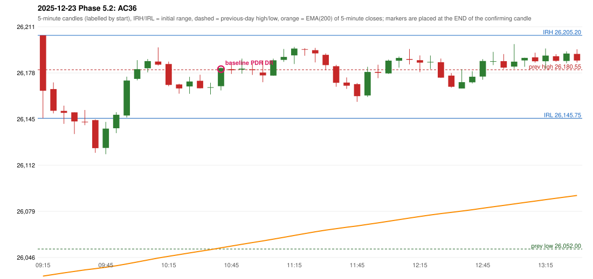

# 2025-12-23 - Phase 5.2 original versus corrected signals

> Signal-level comparison only: no controller, no fills, no P&L. Candidates are NOT approved rules.

## AC36 (PDF page 6) - topic `NOT_ADDRESSED_BY_THE_CALL`

> RF should be activated instead of PDR. | PDR is also wrong.

* Original automated trade: PDR PDR signal 10:45; entry candle OHLC 26168.8/26182.45/26165.75/26181.75; EMA200 at that candle 26052.82; prev_high=26180.55; prev_low=26052.0; prev_close=26172.4; open=26205.2; IRH=26205.2; IRL=26145.75
* Expected (author): RF | not stated
* Current entry conditions: not addressed by the call; unchanged
* Phase 5.2: none
* Evidence: 
* Explicit or ambiguous: n/a; resolved by Phase 5.2: NO - not addressed; remaining decision: see phase51 owner_approval_required.md

### Signal changes under the candidate configurations (this date)

No confirmed-signal difference under any candidate on this date.

