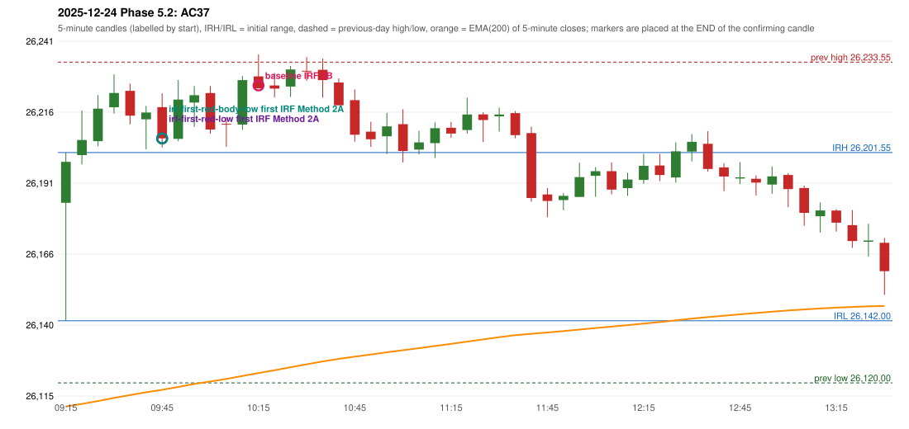

# 2025-12-24 - Phase 5.2 original versus corrected signals

> Signal-level comparison only: no controller, no fills, no P&L. Candidates are NOT approved rules.

## AC37 (PDF page 6) - topic `ORB_MISSING`

> ORB should be activated instead of IRF

* Original automated trade: IRF Method 2B signal 10:20; entry candle OHLC 26228.5/26236.3/26224.25/26224.25; EMA200 at that candle 26123.47; prev_high=26233.55; prev_low=26120.0; prev_close=26177.15; open=26183.75; IRH=26201.55; IRL=26142.0
* Expected (author): ORB | not stated
* Current entry conditions: Methods 1 / 2 / gap setup as encoded (Method 2 inner level and trendline are research variants); strength profile MODERATE (body >= 60%, opposite wick <= 20%) with a conditional pin bar
* Phase 5.2: audit only: the first failing rule per date; no priority override and no threshold change
* Evidence: cause LEVEL_CONSTRUCTION (no previous-day level broken; Method 2 inner level undefined in the source); first candle GREEN body 24.3%; first failing (colour direction): Method 1: NO_SETUP: first candle did not break and close beyond the previous-day high 26233.55; Method 2: NO_SETUP: first candle did not break and close beyond the inner level 26,206.65; Gap/200DMA: NO_SETUP: the gap did not push price through the 200 average
* Explicit or ambiguous: explicit complaint; cause not a single rule; resolved by Phase 5.2: EXPLAINED (cause identified); not changed; remaining decision: O8 (ORB inner level, trendline, strength profile, trend filter)

### Signal changes under the candidate configurations (this date)

| config | strategy | method | change | baseline | candidate | rule cause |
|---|---|---|---|---|---|---|
| phase52-cand-irf-first-red-low | IRF | Method 2A | ADDED |  | 09:50 | IRF 2A candidate: support = LOW of the first red candle (level definit |
| phase52-cand-irf-first-red-body-low | IRF | Method 2A | ADDED |  | 09:50 | IRF 2A candidate: support = BODY LOW of the first red candle (level de |

