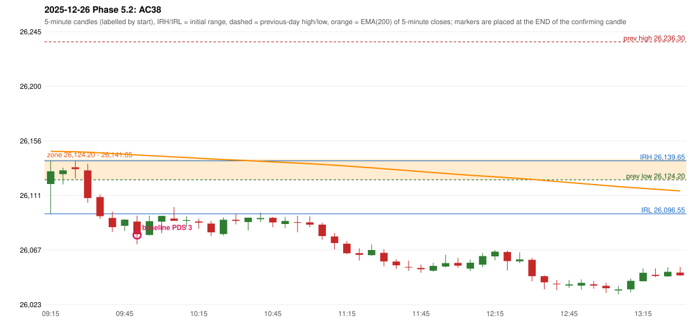

# 2025-12-26 - Phase 5.2 original versus corrected signals

> Signal-level comparison only: no controller, no fills, no P&L. Candidates are NOT approved rules.

## AC38 (PDF page 6) - topic `PDS_FIRST_ELIGIBLE`

> First candle entry.

* Original automated trade: PDS Method 3 signal 09:55; entry candle OHLC 26090.3/26095.1/26071.7/26080.0; EMA200 at that candle 26144.35; prev_high=26236.3; prev_low=26124.2; prev_close=26142.1; open=26120.75; IRH=26139.65; IRL=26096.55
* Expected (author): PDS (first candle entry) | earlier (first candle)
* Current entry conditions: Methods 1/2 on the FIRST red candle at the zone (strong body, or higher-price-rejection pin); a weak first red candle is not taken (PDS-M-001) and Method 3 waits for the small-support break
* Phase 5.2: already satisfied for Methods 1/2/3; the weak-first-candle quality rule is preserved
* Evidence: zone [26124.2, 26141.05], first eligible Method 3 at 09:55, engine 09:55, verdict ENGINE_ON_FIRST_ELIGIBLE_CANDLE
* Explicit or ambiguous: explicit and USER_APPROVED; resolved by Phase 5.2: PARTLY - satisfied under the preserved quality rule (PDS-M-001, Method 3 after a weak first red candle); the author's 'first candle' example is not satisfied; remaining decision: O6 (the weak-first-red-candle quality rule)

### Signal changes under the candidate configurations (this date)

No confirmed-signal difference under any candidate on this date.

