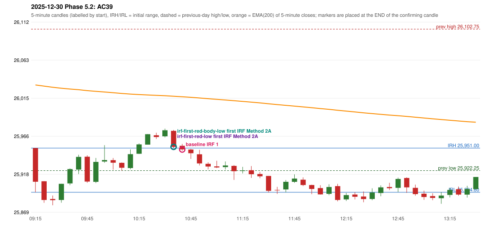

# 2025-12-30 - Phase 5.2 original versus corrected signals

> Signal-level comparison only: no controller, no fills, no P&L. Candidates are NOT approved rules.

## AC39 (PDF page 6) - topic `ORB_MISSING`

> ORB should be activated instead of IRF.

* Original automated trade: IRF Method 1 signal 10:45; entry candle OHLC 25953.9/25956.35/25947.5/25949.3; EMA200 at that candle 26016.47; prev_high=26102.75; prev_low=25922.25; prev_close=25942.1; open=25951.0; IRH=25951.0; IRL=25894.6
* Expected (author): ORB | not stated
* Current entry conditions: Methods 1 / 2 / gap setup as encoded (Method 2 inner level and trendline are research variants); strength profile MODERATE (body >= 60%, opposite wick <= 20%) with a conditional pin bar
* Phase 5.2: audit only: the first failing rule per date; no priority override and no threshold change
* Evidence: cause STRONG_CANDLE_THRESHOLD; first candle RED body 76.2%; first failing (colour direction): Method 1: CANDLE_QUALITY(not a strong body / wick too large); Method 2: CANDLE_QUALITY; Gap/200DMA: NO_SETUP: no gap in this direction
* Explicit or ambiguous: explicit complaint; cause not a single rule; resolved by Phase 5.2: EXPLAINED (cause identified); not changed; remaining decision: O8 (ORB inner level, trendline, strength profile, trend filter)

### Signal changes under the candidate configurations (this date)

| config | strategy | method | change | baseline | candidate | rule cause |
|---|---|---|---|---|---|---|
| phase52-cand-irf-first-red-low | IRF | Method 2A | TIME_SHIFTED_EARLIER | 11:15 | 10:40 | IRF 2A candidate: support = LOW of the first red candle (level definit |
| phase52-cand-irf-first-red-body-low | IRF | Method 2A | TIME_SHIFTED_EARLIER | 11:15 | 10:40 | IRF 2A candidate: support = BODY LOW of the first red candle (level de |

