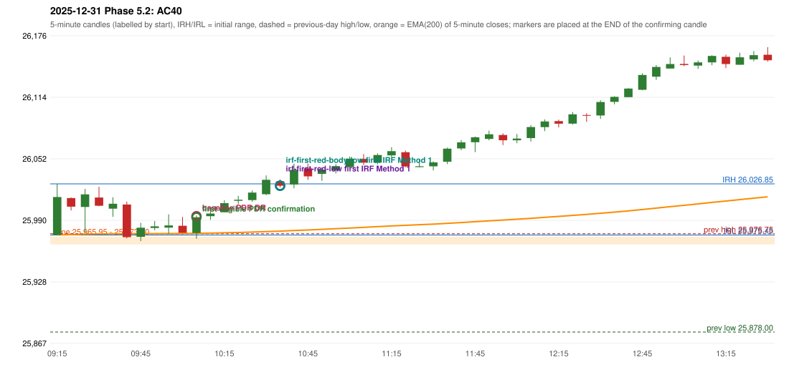

# 2025-12-31 - Phase 5.2 original versus corrected signals

> Signal-level comparison only: no controller, no fills, no P&L. Candidates are NOT approved rules.

## AC40 (PDF page 6) - topic `PDR_FIRST_ELIGIBLE`

> ORB should activate first, Which hits SL Ep then PDR. | PDR 1st candle entry.

* Original automated trade: PDR PDR signal 10:10; entry candle OHLC 25977.5/25995.1/25971.75/25993.3; EMA200 at that candle 25977.15; prev_high=25976.75; prev_low=25878.0; prev_close=25938.85; open=25975.45; IRH=26026.85; IRL=25975.45
* Expected (author): ORB first (it stops out), then PDR on its 1st candle | earlier (ORB first; PDR on the 1st candle)
* Current entry conditions: zone retest, then the first later candle with GOOD_GREEN_BODY (body >= 60%, upper wick <= 20%) or LOWER_PRICE_REJECTION or HAMMER that closes strictly above the zone ceiling; the retest candle itself is not a confirmation (PDR-A07)
* Phase 5.2: already satisfied: the engine activates on the first eligible candle; the numeric thresholds and the retest-candle convention are preserved
* Evidence: zone [25965.95, 25973.7], first touch 09:40, first eligible signal 10:10, engine 10:10, verdict ENGINE_ON_FIRST_ELIGIBLE_CANDLE; author's reading: 09:45 (body 49.7%, upper wick 26.9%, lower wick 23.4%)
* Explicit or ambiguous: explicit and USER_APPROVED; resolved by Phase 5.2: PARTLY - the engine is on the first eligible candle only under the PRESERVED proposals (PDR-A07 retest convention, numeric thresholds); the author's example candle is not eligible under them; remaining decision: O6/O7 (loosen the numeric thresholds? may the retest candle be the confirmation?)

### Signal changes under the candidate configurations (this date)

| config | strategy | method | change | baseline | candidate | rule cause |
|---|---|---|---|---|---|---|
| phase52-cand-irf-first-red-low | IRF | Method 2A | TIME_SHIFTED_EARLIER | 13:40 | 11:25 | IRF 2A candidate: support = LOW of the first red candle (level definit |
| phase52-cand-irf-first-red-low | IRF | Method 2A | REMOVED | 14:25 |  | IRF 2A candidate: support = LOW of the first red candle (level definit |
| phase52-cand-irf-first-red-low | IRF | Method 2A | REMOVED | 15:05 |  | IRF 2A candidate: support = LOW of the first red candle (level definit |
| phase52-cand-irf-first-red-low | IRF | Method 2B | ANNOTATION_ONLY | 11:25 | 11:25 | IRF 2A candidate: support = LOW of the first red candle (level definit |
| phase52-cand-irf-first-red-body-low | IRF | Method 2A | TIME_SHIFTED_EARLIER | 13:40 | 11:25 | IRF 2A candidate: support = BODY LOW of the first red candle (level de |
| phase52-cand-irf-first-red-body-low | IRF | Method 2A | REMOVED | 14:25 |  | IRF 2A candidate: support = BODY LOW of the first red candle (level de |
| phase52-cand-irf-first-red-body-low | IRF | Method 2A | REMOVED | 15:05 |  | IRF 2A candidate: support = BODY LOW of the first red candle (level de |
| phase52-cand-irf-first-red-body-low | IRF | Method 2B | ANNOTATION_ONLY | 11:25 | 11:25 | IRF 2A candidate: support = BODY LOW of the first red candle (level de |

