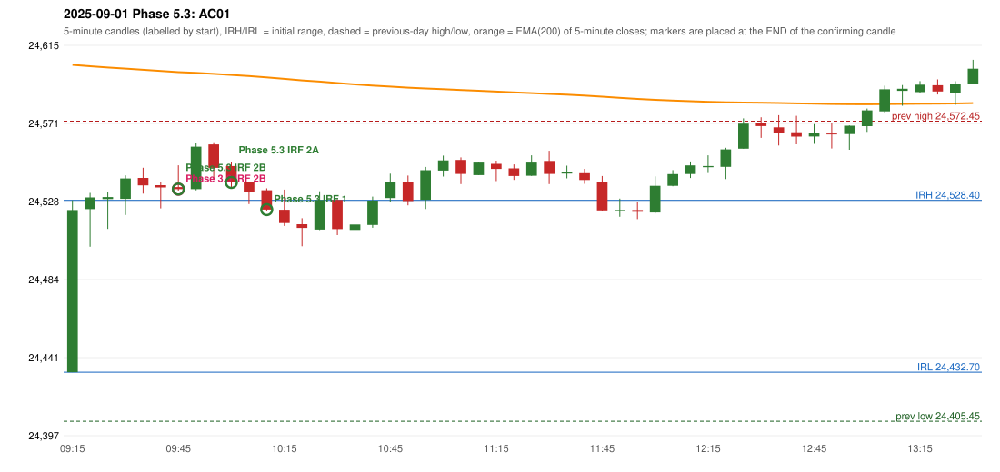

# 2025-09-01 - Phase 5.3 original versus author-corrected signals

> Signal-level comparison only: no controller, no fills, no P&L. Provisional conventions are labelled.

## AC01 (PDF page 1) - topic `IRF_FIRST_RED_CANDLE`

> IRF should be entered at the resistance itself. | Entry can either be break of Support/Resistance which ever happens first. | 60+ body candle in the entry side.

* Phase 3.6 automated signal: IRF Method 2B 09:50; entry candle OHLC 24535.8/24547.9/24533.8/24534.65
* Phase 3.6 signals to 13:00: 09:50 IRF/Method 2B; 10:15 IRF/Method 1; 10:35 IRF/Method 1; 10:55 IRF/Method 1; 11:50 IRF/Method 1; 11:50 IRF/Method 2A
* Phase 5.3 author-corrected signals to 13:00: 09:50 IRF/Method 2B; 10:05 IRF/Method 2A; 10:15 IRF/Method 1; 10:35 IRF/Method 1; 10:55 IRF/Method 1; 10:55 IRF/Method 2B; 11:35 IRF/Method 2B; 11:50 IRF/Method 1
* Reconciliation: **NOT_RECONCILED_METHOD_OUT_OF_SCOPE** - Method 2B has no red-candle-created support (Method 2B's reference is a resistance); the rule is not applied there without source support (scope verification required)

| measurement | value |
|---|---|
| phase53_signals_to_13_00 | 09:50 IRF/Method 2B; 10:05 IRF/Method 2A; 10:15 IRF/Method 1; 10:35 IRF/Method 1; 10:55 IRF/Method 1; 10:55 IRF/Method 2B; 11:35 IRF/Method 2B; 11:50 IRF/Method 1 |
| phase53_irf_result_first_red_low | UNCHANGED (same time and method) |
| phase53_irf_result_red_search_after_breakout | UNCHANGED (same time and method) |
| first_red_candle | 09:35 |
| first_red_candle_low | 24532.15 |

### Changes in the author-corrected configuration on this date (against Phase 3.6)

| strategy | method | change | Phase 3.6 | Phase 5.3 | cause |
|---|---|---|---|---|---|
| IRF | Method 2A | TIME_SHIFTED_EARLIER | 11:50 | 10:05 | all four Phase 5.3 rules together |
| IRF | Method 2B | ADDED |  | 10:55 | all four Phase 5.3 rules together |
| IRF | Method 2B | ADDED |  | 11:35 | all four Phase 5.3 rules together |

