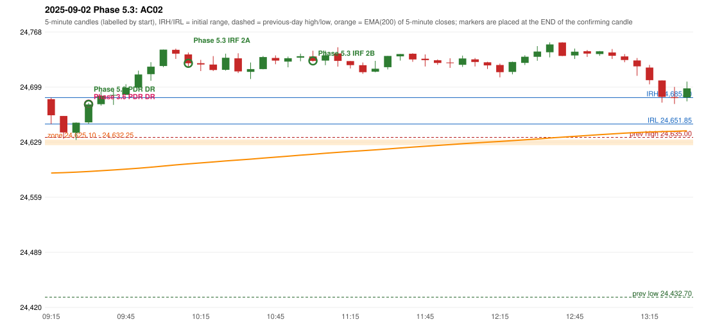

# 2025-09-02 - Phase 5.3 original versus author-corrected signals

> Signal-level comparison only: no controller, no fills, no P&L. Provisional conventions are labelled.

## AC02 (PDF page 1) - topic `PDR_FIRST_ELIGIBLE`

> Enter here | PDR Zone | Support from previous day resistance.

* Phase 3.6 automated signal: PDR PDR 09:35; entry candle OHLC 24653.9/24678.7/24652.0/24676.6
* Phase 3.6 signals to 13:00: 09:35 PDR/PDR; 10:35 IRF/Method 2A; 11:05 IRF/Method 2B; 12:20 IRF/Method 2A
* Phase 5.3 author-corrected signals to 13:00: 09:35 PDR/PDR; 10:15 IRF/Method 2A; 11:05 IRF/Method 2B; 11:25 IRF/Method 2A; 11:55 IRF/Method 2A; 12:20 IRF/Method 2A
* Reconciliation: **NOT_RECONCILED_RETEST_CONVENTION** - the author's candle 09:25 is the RETEST candle; the retest/confirmation sequencing is unresolved and preserved, so the first eligible candle is 09:30 (owner decision)

| measurement | value |
|---|---|
| phase53_signals_to_13_00 | 09:35 PDR/PDR; 10:15 IRF/Method 2A; 11:05 IRF/Method 2B; 11:25 IRF/Method 2A; 11:55 IRF/Method 2A; 12:20 IRF/Method 2A |
| phase53_pdr_first_eligible_candle | 09:30 |
| phase53_pdr_signal | 09:35 |
| author_first_green_candle | 09:25 |
| retest_candle | 09:25 |
| retest_candle_would_qualify | True |

### Changes in the author-corrected configuration on this date (against Phase 3.6)

| strategy | method | change | Phase 3.6 | Phase 5.3 | cause |
|---|---|---|---|---|---|
| IRF | Method 1 | REMOVED | 13:45 |  | all four Phase 5.3 rules together |
| IRF | Method 2A | TIME_SHIFTED_EARLIER | 10:35 | 10:15 | all four Phase 5.3 rules together |
| IRF | Method 2A | TIME_SHIFTED_EARLIER | 12:20 | 11:25 | all four Phase 5.3 rules together |
| IRF | Method 2A | TIME_SHIFTED_EARLIER | 13:10 | 11:55 | all four Phase 5.3 rules together |
| IRF | Method 2A | ADDED |  | 12:20 | all four Phase 5.3 rules together |
| IRF | Method 2A | ADDED |  | 13:10 | all four Phase 5.3 rules together |

### IRF candidates rejected by the 28-point EMA clearance this date

| method | candle | EMA | relation | range distance |
|---|---|---|---|---|
| Method 1 | 13:45 24698.2/24699.3/24649.85/24655.05 | 24643.88 | EMA_BELOW_CANDLE | 5.97 |

