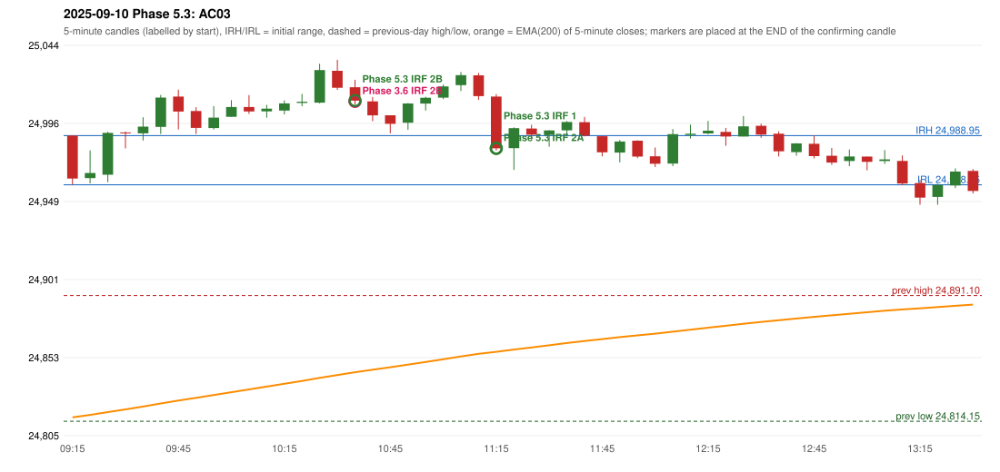

# 2025-09-10 - Phase 5.3 original versus author-corrected signals

> Signal-level comparison only: no controller, no fills, no P&L. Provisional conventions are labelled.

## AC03 (PDF page 1) - topic `IRF_FIRST_RED_CANDLE`

> The first red candle only should be considered. | This candle should be considered | only break of first red candle which is outside the 5 min range, only the red candles break of S/R should be entered.

* Phase 3.6 automated signal: IRF Method 2B 10:40; entry candle OHLC 25018.6/25023.15/25008.05/25010.4
* Phase 3.6 signals to 13:00: 10:40 IRF/Method 2B; 11:20 IRF/Method 1; 11:20 IRF/Method 2A; 11:45 IRF/Method 1; 11:45 IRF/Method 2B; 12:25 IRF/Method 1; 12:35 IRF/Method 2B; 12:40 IRF/Method 1
* Phase 5.3 author-corrected signals to 13:00: 10:40 IRF/Method 2B; 11:20 IRF/Method 1; 11:20 IRF/Method 2A; 11:45 IRF/Method 1; 11:45 IRF/Method 2B; 12:25 IRF/Method 1; 12:35 IRF/Method 2B; 12:40 IRF/Method 1
* Reconciliation: **NOT_RECONCILED_METHOD_OUT_OF_SCOPE** - Method 2B has no red-candle-created support (Method 2B's reference is a resistance); the rule is not applied there without source support (scope verification required)

| measurement | value |
|---|---|
| phase53_signals_to_13_00 | 10:40 IRF/Method 2B; 11:20 IRF/Method 1; 11:20 IRF/Method 2A; 11:45 IRF/Method 1; 11:45 IRF/Method 2B; 12:25 IRF/Method 1; 12:35 IRF/Method 2B; 12:40 IRF/Method 1 |
| phase53_irf_result_first_red_low | UNCHANGED (same time and method) |
| phase53_irf_result_red_search_after_breakout | UNCHANGED (same time and method) |
| first_red_candle | 09:45 |
| first_red_candle_low | 24992.7 |

### Changes in the author-corrected configuration on this date (against Phase 3.6)

| strategy | method | change | Phase 3.6 | Phase 5.3 | cause |
|---|---|---|---|---|---|
| IRF | Method 2A | SAME_TIME_LEVEL_CHANGED | 11:20 | 11:20 | all four Phase 5.3 rules together |

