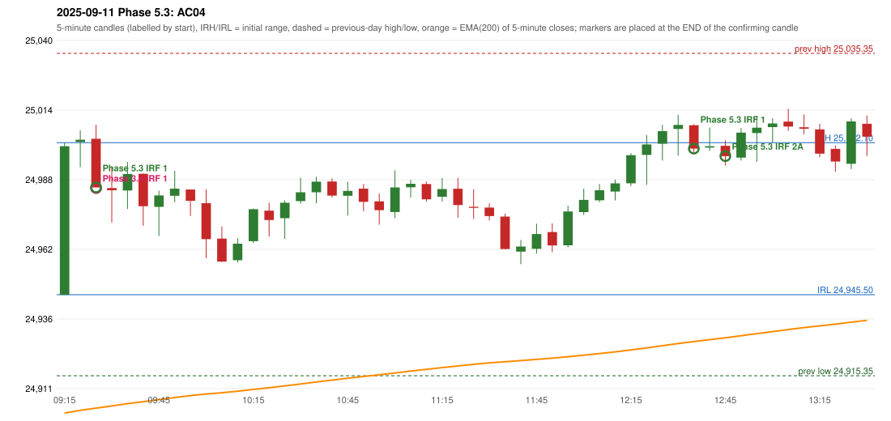

# 2025-09-11 - Phase 5.3 original versus author-corrected signals

> Signal-level comparison only: no controller, no fills, no P&L. Provisional conventions are labelled.

## AC04 (PDF page 1) - topic `ORB_MISSING`

> This should be an ORB trade. | It is shown as IRF, ORB should activate Ep 30 pts SL.

* Phase 3.6 automated signal: IRF Method 1 09:30; entry candle OHLC 25003.55/25008.75/24985.45/24985.45
* Phase 3.6 signals to 13:00: 09:30 IRF/Method 1; 12:40 IRF/Method 1
* Phase 5.3 author-corrected signals to 13:00: 09:30 IRF/Method 1; 12:40 IRF/Method 1; 12:50 IRF/Method 2A
* Reconciliation: **UNRESOLVED_MISSING_DEFINITION** - an objective construction of the Method 2 trendline (which fractals, how many touches, slope tolerance) - the source only draws it

| measurement | value |
|---|---|
| phase53_signals_to_13_00 | 09:30 IRF/Method 1; 12:40 IRF/Method 1; 12:50 IRF/Method 2A |
| orb_cause | METHOD2_TRENDLINE |

### Changes in the author-corrected configuration on this date (against Phase 3.6)

| strategy | method | change | Phase 3.6 | Phase 5.3 | cause |
|---|---|---|---|---|---|
| IRF | Method 2A | ADDED |  | 12:50 | all four Phase 5.3 rules together |
| IRF | Method 2A | ADDED |  | 14:35 | all four Phase 5.3 rules together |

