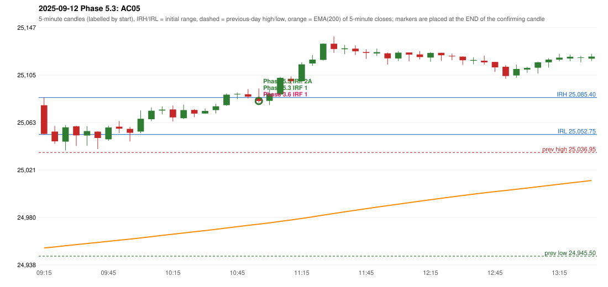

# 2025-09-12 - Phase 5.3 original versus author-corrected signals

> Signal-level comparison only: no controller, no fills, no P&L. Provisional conventions are labelled.

## AC05 (PDF page 1) - topic `NOT_ADDRESSED_BY_THE_CALL`

> This should be RF entry, IRF should not be taken as RF is activated.

* Phase 3.6 automated signal: IRF Method 1 11:00; entry candle OHLC 25084.95/25093.35/25080.85/25082.35
* Phase 3.6 signals to 13:00: 11:00 IRF/Method 1; 12:50 IRF/Method 2A
* Phase 5.3 author-corrected signals to 13:00: 11:00 IRF/Method 1; 11:00 IRF/Method 2A
* Reconciliation: **NOT_IN_SCOPE_UNCHANGED** - not addressed by the Phase 5.3 corrections; behaviour unchanged

| measurement | value |
|---|---|
| phase53_signals_to_13_00 | 11:00 IRF/Method 1; 11:00 IRF/Method 2A |

### Changes in the author-corrected configuration on this date (against Phase 3.6)

| strategy | method | change | Phase 3.6 | Phase 5.3 | cause |
|---|---|---|---|---|---|
| IRF | Method 2A | TIME_SHIFTED_EARLIER | 12:50 | 11:00 | all four Phase 5.3 rules together |
| IRF | Method 2A | REMOVED | 14:40 |  | all four Phase 5.3 rules together |
| IRF | Method 2B | REMOVED | 13:45 |  | all four Phase 5.3 rules together |
| IRF | Method 2B | REMOVED | 15:25 |  | all four Phase 5.3 rules together |

