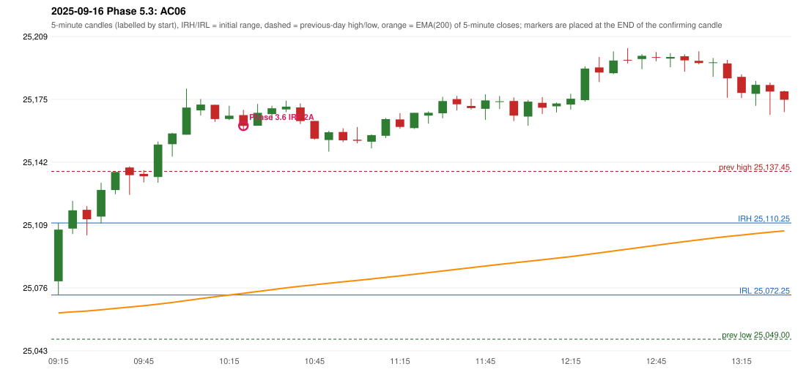

# 2025-09-16 - Phase 5.3 original versus author-corrected signals

> Signal-level comparison only: no controller, no fills, no P&L. Provisional conventions are labelled.

## AC06 (PDF page 2) - topic `ORB_MISSING`

> IRF is taken, which is wrong. | ORB should take place in this condition[s]

* Phase 3.6 automated signal: IRF Method 2A 10:25; entry candle OHLC 25167.1/25169.9/25158.95/25161.45
* Phase 3.6 signals to 13:00: 10:25 IRF/Method 2A; 10:45 IRF/Method 2B
* Phase 5.3 author-corrected signals to 13:00: 
* Reconciliation: **UNRESOLVED_MISSING_DEFINITION** - the level the author drew: Method 2's inner support/resistance is not defined in the rulebook (the engine has no level to break when the first candle does not break the previous-day high/low)

| measurement | value |
|---|---|
| phase53_signals_to_13_00 |  |
| orb_cause | LEVEL_CONSTRUCTION |

### Changes in the author-corrected configuration on this date (against Phase 3.6)

| strategy | method | change | Phase 3.6 | Phase 5.3 | cause |
|---|---|---|---|---|---|
| IRF | Method 2A | REMOVED | 10:25 |  | all four Phase 5.3 rules together |
| IRF | Method 2A | REMOVED | 13:15 |  | all four Phase 5.3 rules together |
| IRF | Method 2B | REMOVED | 10:45 |  | all four Phase 5.3 rules together |
| IRF | Method 2B | REMOVED | 14:10 |  | all four Phase 5.3 rules together |
| IRF | Method 2B | REMOVED | 15:00 |  | all four Phase 5.3 rules together |

