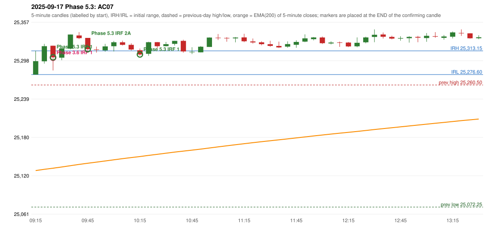

# 2025-09-17 - Phase 5.3 original versus author-corrected signals

> Signal-level comparison only: no controller, no fills, no P&L. Provisional conventions are labelled.

## AC07 (PDF page 2) - topic `IRF_ENTRY_BODY (not in the call)`

> IRF should be taken after 5 candles at 6th candle, because the entry candle body is 40% Wick is 60%. | entry should be activated here. | This should be ignored.

* Phase 3.6 automated signal: IRF Method 1 09:30; entry candle OHLC 25321.05/25321.05/25282.95/25303.2
* Phase 3.6 signals to 13:00: 09:30 IRF/Method 1; 10:20 IRF/Method 1; 10:20 IRF/Method 2A; 10:45 IRF/Method 1; 10:45 IRF/Method 2B; 11:20 IRF/Method 2B; 12:40 IRF/Method 2B
* Phase 5.3 author-corrected signals to 13:00: 09:30 IRF/Method 1; 09:50 IRF/Method 2A; 10:20 IRF/Method 1; 10:45 IRF/Method 1; 10:45 IRF/Method 2B; 11:20 IRF/Method 2A; 11:20 IRF/Method 2B; 12:40 IRF/Method 2B
* Reconciliation: **NOT_ADDRESSED_PENDING_OWNER** - entry-candle body threshold (60/50/40 %) is not part of the Phase 5.3 approvals

| measurement | value |
|---|---|
| phase53_signals_to_13_00 | 09:30 IRF/Method 1; 09:50 IRF/Method 2A; 10:20 IRF/Method 1; 10:45 IRF/Method 1; 10:45 IRF/Method 2B; 11:20 IRF/Method 2A; 11:20 IRF/Method 2B; 12:40 IRF/Method 2B |

### Changes in the author-corrected configuration on this date (against Phase 3.6)

| strategy | method | change | Phase 3.6 | Phase 5.3 | cause |
|---|---|---|---|---|---|
| IRF | Method 2A | TIME_SHIFTED_EARLIER | 10:20 | 09:50 | all four Phase 5.3 rules together |
| IRF | Method 2A | ADDED |  | 11:20 | all four Phase 5.3 rules together |

