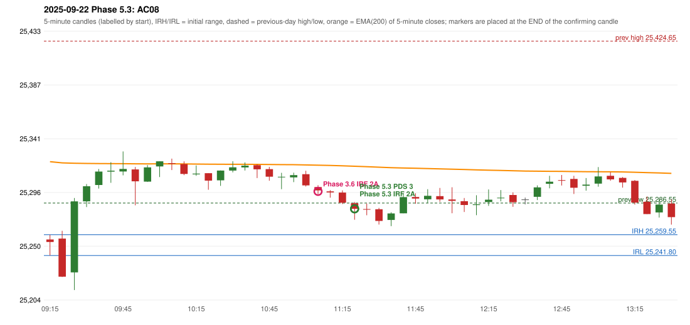

# 2025-09-22 - Phase 5.3 original versus author-corrected signals

> Signal-level comparison only: no controller, no fills, no P&L. Provisional conventions are labelled.

## AC08 (PDF page 2) - topic `IRF_FIRST_RED_CANDLE`

> Entry should have activated earlier, marking first red candles Support/Resista[nce]

* Phase 3.6 automated signal: IRF Method 2A 11:10; entry candle OHLC 25300.2/25301.8/25294.15/25297.4
* Phase 3.6 signals to 13:00: 11:10 IRF/Method 2A; 11:25 PDS/Method 3; 12:55 IRF/Method 2B
* Phase 5.3 author-corrected signals to 13:00: 11:25 IRF/Method 2A; 11:25 PDS/Method 3
* Reconciliation: **NOT_RECONCILED** - author expects earlier; first-red-low gives: later (11:10 -> 11:25 Method 2A)

| measurement | value |
|---|---|
| phase53_signals_to_13_00 | 11:25 IRF/Method 2A; 11:25 PDS/Method 3 |
| phase53_irf_result_first_red_low | later (11:10 -> 11:25 Method 2A) |
| phase53_irf_result_red_search_after_breakout | later (11:10 -> 11:25 Method 2A) |
| first_red_candle | 09:50 |
| first_red_candle_low | 25284.65 |

### Changes in the author-corrected configuration on this date (against Phase 3.6)

| strategy | method | change | Phase 3.6 | Phase 5.3 | cause |
|---|---|---|---|---|---|
| IRF | Method 2A | TIME_SHIFTED_LATER | 11:10 | 11:25 | all four Phase 5.3 rules together |
| IRF | Method 2A | SAME_TIME_LEVEL_CHANGED | 14:00 | 14:00 | all four Phase 5.3 rules together |
| IRF | Method 2B | TIME_SHIFTED_LATER | 12:55 | 14:00 | all four Phase 5.3 rules together |
| PDS | Method 1 | ADDED |  | 13:35 | all four Phase 5.3 rules together |
| PDS | Method 2 | ADDED |  | 13:55 | all four Phase 5.3 rules together |
| PDS | Method 3 | REMOVED | 14:00 |  | all four Phase 5.3 rules together |

### IRF candidates rejected by the 28-point EMA clearance this date

| method | candle | EMA | relation | range distance |
|---|---|---|---|---|
| Method 2A | 12:10 25288.15/25290.9/25278.95/25284.9 | 25315.17 | EMA_ABOVE_CANDLE | 24.27 |
| Method 2A | 12:15 25284.85/25293.25/25276.2/25285.5 | 25314.88 | EMA_ABOVE_CANDLE | 21.63 |
| Method 2B | 12:55 25307.15/25309.8/25294.3/25299.65 | 25313.43 | EMA_ABOVE_CANDLE | 3.63 |
| Method 2B | 13:20 25305.55/25306.25/25285.25/25287.0 | 25312.87 | EMA_ABOVE_CANDLE | 6.62 |
| Method 2A | 13:25 25287.7/25292.15/25277.15/25277.2 | 25312.51 | EMA_ABOVE_CANDLE | 20.36 |
| Method 2B | 13:25 25287.7/25292.15/25277.15/25277.2 | 25312.51 | EMA_ABOVE_CANDLE | 20.36 |
| Method 2A | 13:30 25278.6/25290.25/25274.2/25285.3 | 25312.24 | EMA_ABOVE_CANDLE | 21.99 |
| Method 2A | 13:35 25286.15/25289.65/25268.15/25274.6 | 25311.87 | EMA_ABOVE_CANDLE | 22.22 |
| Method 2B | 13:35 25286.15/25289.65/25268.15/25274.6 | 25311.87 | EMA_ABOVE_CANDLE | 22.22 |
| Method 2A | 13:40 25274.85/25283.85/25272.4/25279.15 | 25311.54 | EMA_ABOVE_CANDLE | 27.69 |
| Method 2A | 13:45 25278.85/25284.1/25277.35/25277.35 | 25311.20 | EMA_ABOVE_CANDLE | 27.10 |
| Method 2B | 13:45 25278.85/25284.1/25277.35/25277.35 | 25311.20 | EMA_ABOVE_CANDLE | 27.10 |
| Method 2A | 13:50 25278.3/25283.4/25274.0/25280.7 | 25310.90 | EMA_ABOVE_CANDLE | 27.50 |
| Method 2A | 13:55 25280.6/25288.8/25272.35/25273.55 | 25310.52 | EMA_ABOVE_CANDLE | 21.72 |
| Method 2B | 13:55 25280.6/25288.8/25272.35/25273.55 | 25310.52 | EMA_ABOVE_CANDLE | 21.72 |

