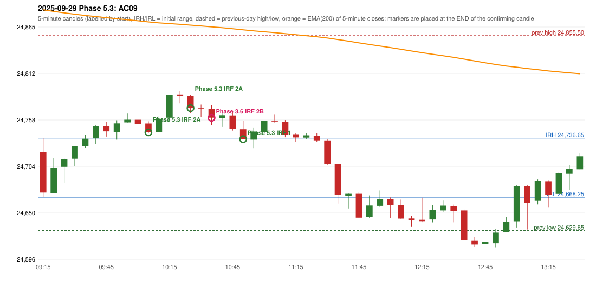

# 2025-09-29 - Phase 5.3 original versus author-corrected signals

> Signal-level comparison only: no controller, no fills, no P&L. Provisional conventions are labelled.

## AC09 (PDF page 2) - topic `IRF_FIRST_RED_CANDLE`

> Late entry, red candle should be marked, 1st red candle.

* Phase 3.6 automated signal: IRF Method 2B 10:40; entry candle OHLC 24770.45/24774.9/24751.8/24760.5
* Phase 3.6 signals to 13:00: 10:40 IRF/Method 2B; 10:55 IRF/Method 1; 11:30 IRF/Method 1
* Phase 5.3 author-corrected signals to 13:00: 10:10 IRF/Method 2A; 10:30 IRF/Method 2A; 10:55 IRF/Method 1; 11:30 IRF/Method 1
* Reconciliation: **RECONCILED_DIRECTION** - earlier (10:40 -> 10:10 Method 2A)

| measurement | value |
|---|---|
| phase53_signals_to_13_00 | 10:10 IRF/Method 2A; 10:30 IRF/Method 2A; 10:55 IRF/Method 1; 11:30 IRF/Method 1 |
| phase53_irf_result_first_red_low | earlier (10:40 -> 10:10 Method 2A) |
| phase53_irf_result_red_search_after_breakout | UNCHANGED (same time and method) |
| first_red_candle | 10:00 |
| first_red_candle_low | 24751.85 |

### Changes in the author-corrected configuration on this date (against Phase 3.6)

| strategy | method | change | Phase 3.6 | Phase 5.3 | cause |
|---|---|---|---|---|---|
| IRF | Method 2A | ADDED |  | 10:10 | all four Phase 5.3 rules together |
| IRF | Method 2A | ADDED |  | 10:30 | all four Phase 5.3 rules together |
| IRF | Method 2B | REMOVED | 10:40 |  | all four Phase 5.3 rules together |

