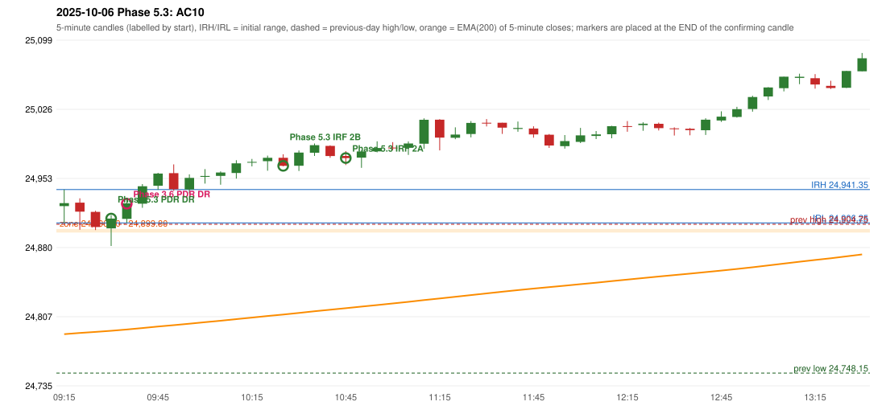

# 2025-10-06 - Phase 5.3 original versus author-corrected signals

> Signal-level comparison only: no controller, no fills, no P&L. Provisional conventions are labelled.

## AC10 (PDF page 2) - topic `PDR_FIRST_ELIGIBLE`

> Long. | Enter in 1st green candle.

* Phase 3.6 automated signal: PDR PDR 09:40; entry candle OHLC 24910.45/24931.05/24906.3/24926.85
* Phase 3.6 signals to 13:00: 09:40 PDR/PDR; 10:30 IRF/Method 2B; 11:05 IRF/Method 2B; 11:50 IRF/Method 2A; 12:30 IRF/Method 2B
* Phase 5.3 author-corrected signals to 13:00: 09:35 PDR/PDR; 10:30 IRF/Method 2B; 10:50 IRF/Method 2A; 11:55 IRF/Method 2B; 12:30 IRF/Method 2B
* Reconciliation: **RECONCILED** - Phase 5.3 first eligible confirmation candle 09:30 = the author's first green candle 09:30

| measurement | value |
|---|---|
| phase53_signals_to_13_00 | 09:35 PDR/PDR; 10:30 IRF/Method 2B; 10:50 IRF/Method 2A; 11:55 IRF/Method 2B; 12:30 IRF/Method 2B |
| phase53_pdr_first_eligible_candle | 09:30 |
| phase53_pdr_signal | 09:35 |
| author_first_green_candle | 09:30 |
| retest_candle | 09:20 |
| retest_candle_would_qualify | True |

### Changes in the author-corrected configuration on this date (against Phase 3.6)

| strategy | method | change | Phase 3.6 | Phase 5.3 | cause |
|---|---|---|---|---|---|
| IRF | Method 2A | TIME_SHIFTED_EARLIER | 11:50 | 10:50 | all four Phase 5.3 rules together |
| IRF | Method 2A | SAME_TIME_LEVEL_CHANGED | 14:30 | 14:30 | all four Phase 5.3 rules together |
| IRF | Method 2A | ADDED |  | 14:50 | all four Phase 5.3 rules together |
| IRF | Method 2B | TIME_SHIFTED_LATER | 11:05 | 11:55 | all four Phase 5.3 rules together |
| PDR | PDR | TIME_SHIFTED_EARLIER | 09:40 | 09:35 | all four Phase 5.3 rules together |

