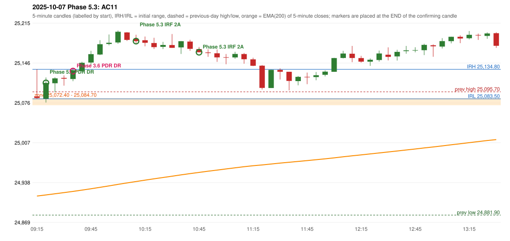

# 2025-10-07 - Phase 5.3 original versus author-corrected signals

> Signal-level comparison only: no controller, no fills, no P&L. Provisional conventions are labelled.

## AC11 (PDF page 2) - topic `PDR_FIRST_ELIGIBLE`

> Entry in 1st green candle.

* Phase 3.6 automated signal: PDR PDR 09:40; entry candle OHLC 25117.9/25134.45/25114.15/25133.1
* Phase 3.6 signals to 13:00: 09:40 PDR/PDR; 11:00 IRF/Method 2A; 11:25 IRF/Method 1; 12:15 IRF/Method 2B; 13:00 IRF/Method 2B
* Phase 5.3 author-corrected signals to 13:00: 09:25 PDR/PDR; 10:15 IRF/Method 2A; 10:50 IRF/Method 2A; 11:25 IRF/Method 1; 12:15 IRF/Method 2B; 13:00 IRF/Method 2B
* Reconciliation: **RECONCILED** - Phase 5.3 first eligible confirmation candle 09:20 = the author's first green candle 09:20

| measurement | value |
|---|---|
| phase53_signals_to_13_00 | 09:25 PDR/PDR; 10:15 IRF/Method 2A; 10:50 IRF/Method 2A; 11:25 IRF/Method 1; 12:15 IRF/Method 2B; 13:00 IRF/Method 2B |
| phase53_pdr_first_eligible_candle | 09:20 |
| phase53_pdr_signal | 09:25 |
| author_first_green_candle | 09:20 |
| retest_candle | 09:15 |
| retest_candle_would_qualify | False |

### Changes in the author-corrected configuration on this date (against Phase 3.6)

| strategy | method | change | Phase 3.6 | Phase 5.3 | cause |
|---|---|---|---|---|---|
| IRF | Method 2A | TIME_SHIFTED_EARLIER | 11:00 | 10:15 | all four Phase 5.3 rules together |
| IRF | Method 2A | TIME_SHIFTED_EARLIER | 13:35 | 10:50 | all four Phase 5.3 rules together |
| IRF | Method 2A | TIME_SHIFTED_EARLIER | 14:30 | 13:35 | all four Phase 5.3 rules together |
| IRF | Method 2A | ADDED |  | 13:55 | all four Phase 5.3 rules together |
| IRF | Method 2A | ADDED |  | 14:25 | all four Phase 5.3 rules together |
| IRF | Method 2B | REMOVED | 14:00 |  | all four Phase 5.3 rules together |
| PDR | PDR | TIME_SHIFTED_EARLIER | 09:40 | 09:25 | all four Phase 5.3 rules together |

