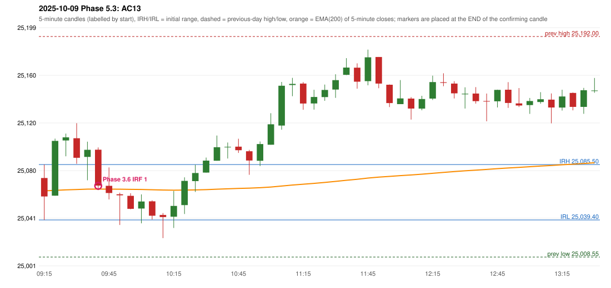

# 2025-10-09 - Phase 5.3 original versus author-corrected signals

> Signal-level comparison only: no controller, no fills, no P&L. Provisional conventions are labelled.

## AC13 (PDF page 3) - topic `IRF_EMA_28`

> Wait for EMA. | The candle should close below EMA when the space btn. the entry candle is less than 27. | Wait. | 200 EMA [5 min TF] | Entry.

* Phase 3.6 automated signal: IRF Method 1 09:45; entry candle OHLC 25097.85/25099.7/25064.25/25068.0
* Phase 3.6 signals to 13:00: 09:45 IRF/Method 1; 12:00 IRF/Method 2A; 12:25 IRF/Method 2B
* Phase 5.3 author-corrected signals to 13:00: 
* Reconciliation: **PARTIAL_REJECTED_NOT_DELAYED** - the signal is rejected (range clearance 0.00 < 28); the author's 'wait for the EMA break' alternative is not modelled (no rule defined)

| measurement | value |
|---|---|
| phase53_signals_to_13_00 |  |
| close_distance_to_ema | 2.92640380451121 |
| range_clearance | 0.0 |
| ema_relation | EMA_INSIDE_CANDLE |
| ema_between_entry_and_t1 | True |

### Changes in the author-corrected configuration on this date (against Phase 3.6)

| strategy | method | change | Phase 3.6 | Phase 5.3 | cause |
|---|---|---|---|---|---|
| IRF | Method 1 | REMOVED | 09:45 |  | all four Phase 5.3 rules together |
| IRF | Method 2A | REMOVED | 12:00 |  | all four Phase 5.3 rules together |
| IRF | Method 2A | REMOVED | 14:15 |  | all four Phase 5.3 rules together |
| IRF | Method 2B | REMOVED | 12:25 |  | all four Phase 5.3 rules together |
| IRF | Method 2B | REMOVED | 14:15 |  | all four Phase 5.3 rules together |

### IRF candidates rejected by the 28-point EMA clearance this date

| method | candle | EMA | relation | range distance |
|---|---|---|---|---|
| Method 2A | 09:45 25097.85/25099.7/25064.25/25068.0 | 25065.07 | EMA_INSIDE_CANDLE | 0.00 |
| Method 2A | 09:50 25067.8/25083.1/25056.45/25061.8 | 25065.04 | EMA_INSIDE_CANDLE | 0.00 |
| Method 2A | 09:55 25060.75/25062.1/25035.2/25059.9 | 25064.99 | EMA_ABOVE_CANDLE | 2.89 |
| Method 2A | 10:00 25059.45/25061.6/25048.3/25048.6 | 25064.83 | EMA_ABOVE_CANDLE | 3.23 |
| Method 2A | 10:05 25048.9/25060.65/25036.6/25054.75 | 25064.73 | EMA_ABOVE_CANDLE | 4.08 |
| Method 2A | 10:10 25054.9/25055.7/25039.75/25042.9 | 25064.51 | EMA_ABOVE_CANDLE | 8.81 |
| Method 2A | 10:15 25043.55/25045.1/25024.3/25041.8 | 25064.28 | EMA_ABOVE_CANDLE | 19.18 |
| Method 2A | 10:20 25042.05/25063.55/25032.75/25051.05 | 25064.15 | EMA_ABOVE_CANDLE | 0.60 |
| Method 2A | 10:25 25051.75/25074.85/25044.35/25071.9 | 25064.23 | EMA_INSIDE_CANDLE | 0.00 |
| Method 2A | 10:30 25071.7/25085.3/25062.7/25078.45 | 25064.37 | EMA_INSIDE_CANDLE | 0.00 |
| Method 1 | 09:45 25097.85/25099.7/25064.25/25068.0 | 25065.07 | EMA_INSIDE_CANDLE | 0.00 |

