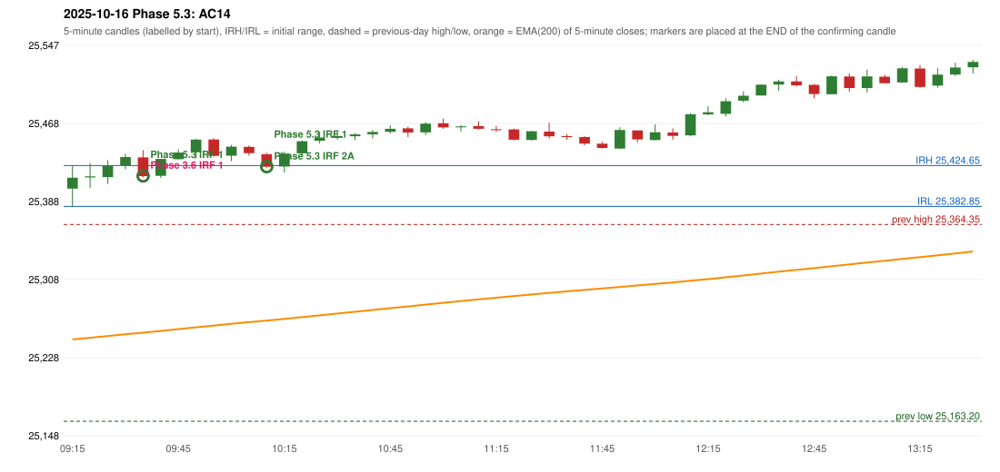

# 2025-10-16 - Phase 5.3 original versus author-corrected signals

> Signal-level comparison only: no controller, no fills, no P&L. Provisional conventions are labelled.

## AC14 (PDF page 3) - topic `ORB_MISSING`

> ORB should have activated, instead IRF is activated.

* Phase 3.6 automated signal: IRF Method 1 09:40; entry candle OHLC 25433.0/25440.35/25412.55/25413.8
* Phase 3.6 signals to 13:00: 09:40 IRF/Method 1; 10:15 IRF/Method 1; 10:15 IRF/Method 2A; 10:55 IRF/Method 2B; 11:25 IRF/Method 2A; 11:45 IRF/Method 2A; 12:10 IRF/Method 2B; 13:00 IRF/Method 2B
* Phase 5.3 author-corrected signals to 13:00: 09:40 IRF/Method 1; 10:15 IRF/Method 1; 10:15 IRF/Method 2A; 10:55 IRF/Method 2B; 11:20 IRF/Method 2A; 11:45 IRF/Method 2A; 12:10 IRF/Method 2B; 12:50 IRF/Method 2A
* Reconciliation: **UNRESOLVED_MISSING_DEFINITION** - the ORB strong-candle definition (body %, opposite-wick %) or an approval of a looser profile - the rulebook gives no numbers

| measurement | value |
|---|---|
| phase53_signals_to_13_00 | 09:40 IRF/Method 1; 10:15 IRF/Method 1; 10:15 IRF/Method 2A; 10:55 IRF/Method 2B; 11:20 IRF/Method 2A; 11:45 IRF/Method 2A; 12:10 IRF/Method 2B; 12:50 IRF/Method 2A |
| orb_cause | STRONG_CANDLE_THRESHOLD |

### Changes in the author-corrected configuration on this date (against Phase 3.6)

| strategy | method | change | Phase 3.6 | Phase 5.3 | cause |
|---|---|---|---|---|---|
| IRF | Method 2A | SAME_TIME_LEVEL_CHANGED | 10:15 | 10:15 | all four Phase 5.3 rules together |
| IRF | Method 2A | TIME_SHIFTED_EARLIER | 11:25 | 11:20 | all four Phase 5.3 rules together |
| IRF | Method 2A | SAME_TIME_LEVEL_CHANGED | 11:45 | 11:45 | all four Phase 5.3 rules together |
| IRF | Method 2A | TIME_SHIFTED_EARLIER | 15:15 | 12:50 | all four Phase 5.3 rules together |
| IRF | Method 2B | TIME_SHIFTED_LATER | 13:00 | 13:20 | all four Phase 5.3 rules together |
| IRF | Method 2B | REMOVED | 13:20 |  | all four Phase 5.3 rules together |

