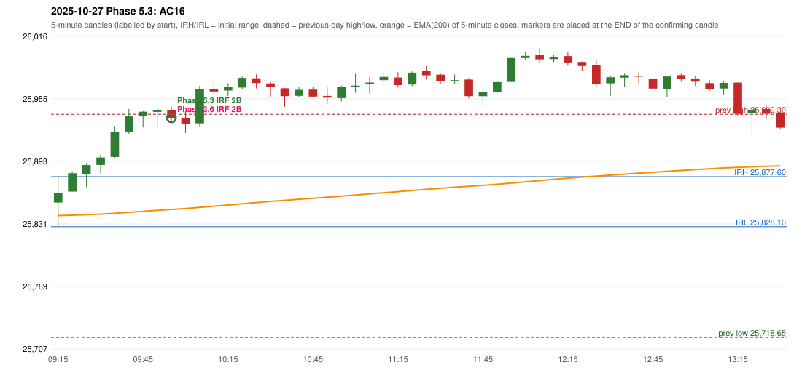

# 2025-10-27 - Phase 5.3 original versus author-corrected signals

> Signal-level comparison only: no controller, no fills, no P&L. Provisional conventions are labelled.

## AC16 (PDF page 3) - topic `ORB_MISSING`

> ORB should have activated, instead IRF is activated. | IRF activation is also wrong.

* Phase 3.6 automated signal: IRF Method 2B 10:00; entry candle OHLC 25943.45/25946.45/25931.65/25935.85
* Phase 3.6 signals to 13:00: 10:00 IRF/Method 2B; 11:45 IRF/Method 2A; 12:25 IRF/Method 2A
* Phase 5.3 author-corrected signals to 13:00: 10:00 IRF/Method 2B
* Reconciliation: **UNRESOLVED_MISSING_DEFINITION** - the exact trend filter (previous-session close against its EMA, or the first candle's close against EMA(200), or none)

| measurement | value |
|---|---|
| phase53_signals_to_13_00 | 10:00 IRF/Method 2B |
| orb_cause | EMA_REQUIREMENT |

### Changes in the author-corrected configuration on this date (against Phase 3.6)

| strategy | method | change | Phase 3.6 | Phase 5.3 | cause |
|---|---|---|---|---|---|
| IRF | Method 2A | TIME_SHIFTED_LATER | 11:45 | 13:20 | all four Phase 5.3 rules together |
| IRF | Method 2A | REMOVED | 12:25 |  | all four Phase 5.3 rules together |
| IRF | Method 2A | REMOVED | 13:20 |  | all four Phase 5.3 rules together |
| IRF | Method 2B | TIME_SHIFTED_EARLIER | 14:15 | 13:20 | all four Phase 5.3 rules together |
| IRF | Method 2B | TIME_SHIFTED_EARLIER | 14:40 | 14:15 | all four Phase 5.3 rules together |
| IRF | Method 2B | ADDED |  | 14:40 | all four Phase 5.3 rules together |

