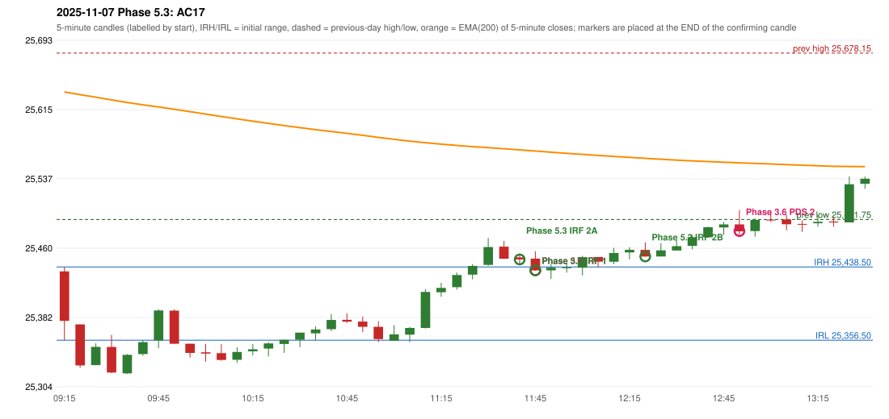

# 2025-11-07 - Phase 5.3 original versus author-corrected signals

> Signal-level comparison only: no controller, no fills, no P&L. Provisional conventions are labelled.

## AC17 (PDF page 3) - topic `NOT_ADDRESSED_BY_THE_CALL`

> IRF should activate first which gives an SL. | 2nd trade should be PDS.

* Phase 3.6 automated signal: PDS Method 2 12:55; entry candle OHLC 25486.2/25502.35/25474.75/25478.45
* Phase 3.6 signals to 13:00: 11:50 IRF/Method 1; 12:55 PDS/Method 2
* Phase 5.3 author-corrected signals to 13:00: 11:45 IRF/Method 2A; 11:50 IRF/Method 1; 12:25 IRF/Method 2B; 12:55 PDS/Method 2
* Reconciliation: **NOT_IN_SCOPE_UNCHANGED** - not addressed by the Phase 5.3 corrections; behaviour unchanged

| measurement | value |
|---|---|
| phase53_signals_to_13_00 | 11:45 IRF/Method 2A; 11:50 IRF/Method 1; 12:25 IRF/Method 2B; 12:55 PDS/Method 2 |

### Changes in the author-corrected configuration on this date (against Phase 3.6)

| strategy | method | change | Phase 3.6 | Phase 5.3 | cause |
|---|---|---|---|---|---|
| IRF | Method 2A | TIME_SHIFTED_EARLIER | 14:05 | 11:45 | all four Phase 5.3 rules together |
| IRF | Method 2A | ADDED |  | 14:05 | all four Phase 5.3 rules together |
| IRF | Method 2A | ADDED |  | 14:50 | all four Phase 5.3 rules together |
| IRF | Method 2B | TIME_SHIFTED_EARLIER | 14:05 | 12:25 | all four Phase 5.3 rules together |

### IRF candidates rejected by the 28-point EMA clearance this date

| method | candle | EMA | relation | range distance |
|---|---|---|---|---|
| Method 2A | 14:40 25518.8/25524.5/25514.25/25515.3 | 25545.78 | EMA_ABOVE_CANDLE | 21.28 |
| Method 2A | 14:45 25515.25/25518.9/25507.75/25512.75 | 25545.46 | EMA_ABOVE_CANDLE | 26.56 |

