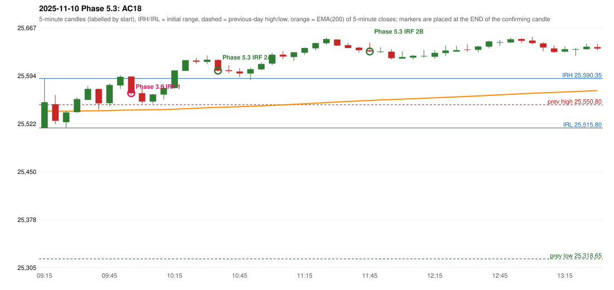

# 2025-11-10 - Phase 5.3 original versus author-corrected signals

> Signal-level comparison only: no controller, no fills, no P&L. Provisional conventions are labelled.

## AC18 (PDF page 4) - topic `IRF_EMA_28`

> Should be ignored as Tgt 1 is not above EMA, tgt 1 is less than 27. | Should wait until EMA break.

* Phase 3.6 automated signal: IRF Method 1 10:00; entry candle OHLC 25593.3/25593.65/25565.05/25568.1
* Phase 3.6 signals to 13:00: 10:00 IRF/Method 1; 11:10 IRF/Method 2B; 11:50 IRF/Method 2B
* Phase 5.3 author-corrected signals to 13:00: 10:40 IRF/Method 2A; 11:50 IRF/Method 2B
* Reconciliation: **PARTIAL_REJECTED_NOT_DELAYED** - the signal is rejected (range clearance 22.22 < 28); the author's 'wait for the EMA break' alternative is not modelled (no rule defined)

| measurement | value |
|---|---|
| phase53_signals_to_13_00 | 10:40 IRF/Method 2A; 11:50 IRF/Method 2B |
| close_distance_to_ema | 25.269671700712934 |
| range_clearance | 22.21967170071366 |
| ema_relation | EMA_BELOW_CANDLE |
| ema_between_entry_and_t1 | True |

### Changes in the author-corrected configuration on this date (against Phase 3.6)

| strategy | method | change | Phase 3.6 | Phase 5.3 | cause |
|---|---|---|---|---|---|
| IRF | Method 1 | REMOVED | 10:00 |  | all four Phase 5.3 rules together |
| IRF | Method 2A | ADDED |  | 10:40 | all four Phase 5.3 rules together |
| IRF | Method 2A | ADDED |  | 13:05 | all four Phase 5.3 rules together |
| IRF | Method 2B | TIME_SHIFTED_LATER | 11:10 | 11:50 | all four Phase 5.3 rules together |
| IRF | Method 2B | TIME_SHIFTED_LATER | 11:50 | 13:05 | all four Phase 5.3 rules together |
| IRF | Method 2B | REMOVED | 13:05 |  | all four Phase 5.3 rules together |

### IRF candidates rejected by the 28-point EMA clearance this date

| method | candle | EMA | relation | range distance |
|---|---|---|---|---|
| Method 1 | 10:00 25593.3/25593.65/25565.05/25568.1 | 25542.83 | EMA_BELOW_CANDLE | 22.22 |

