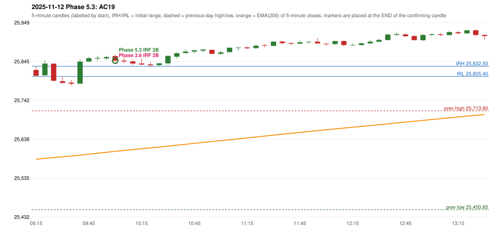

# 2025-11-12 - Phase 5.3 original versus author-corrected signals

> Signal-level comparison only: no controller, no fills, no P&L. Provisional conventions are labelled.

## AC19 (PDF page 4) - topic `IRF_DAY_LOW`

> This day trading should be completely stopped as IRF is already activate[d] Ep entry is below days low.

* Phase 3.6 automated signal: IRF Method 2B 10:05; entry candle OHLC 25859.4/25863.85/25844.3/25847.3
* Phase 3.6 signals to 13:00: 10:05 IRF/Method 2B
* Phase 5.3 author-corrected signals to 13:00: 10:05 IRF/Method 2B
* Reconciliation: **PENDING_OWNER_DEFINITION** - the day's-low predicate is unresolved; the previous behaviour is preserved (diagnostics in irf_day_low_diagnostics.csv)

| measurement | value |
|---|---|
| phase53_signals_to_13_00 | 10:05 IRF/Method 2B |

### Changes in the author-corrected configuration on this date (against Phase 3.6)

| strategy | method | change | Phase 3.6 | Phase 5.3 | cause |
|---|---|---|---|---|---|
| IRF | Method 2A | TIME_SHIFTED_LATER | 14:10 | 15:25 | all four Phase 5.3 rules together |
| IRF | Method 2B | ADDED |  | 15:25 | all four Phase 5.3 rules together |

