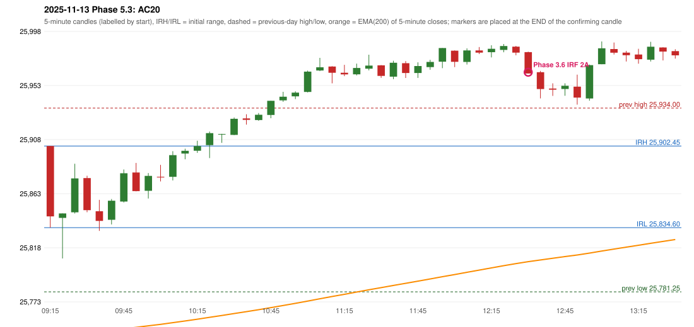

# 2025-11-13 - Phase 5.3 original versus author-corrected signals

> Signal-level comparison only: no controller, no fills, no P&L. Provisional conventions are labelled.

## AC20 (PDF page 4) - topic `IRF_FIRST_RED_CANDLE`

> First red candle only should be considered.

* Phase 3.6 automated signal: IRF Method 2A 12:35; entry candle OHLC 25980.55/25980.9/25962.75/25962.75
* Phase 3.6 signals to 13:00: 12:35 IRF/Method 2A
* Phase 5.3 author-corrected signals to 13:00: 
* Reconciliation: **APPLIED_NO_OBSERVABLE_EXPECTATION** - the author states only 'first red candle'; Method 2A support is now that candle's LOW; outcome on this date: NO IRF SIGNAL within 13:00

| measurement | value |
|---|---|
| phase53_signals_to_13_00 |  |
| phase53_irf_result_first_red_low | NO IRF SIGNAL within 13:00 |
| phase53_irf_result_red_search_after_breakout | NO IRF SIGNAL within 13:00 |
| first_red_candle | 10:35 |
| first_red_candle_low | 25920.25 |

### Changes in the author-corrected configuration on this date (against Phase 3.6)

| strategy | method | change | Phase 3.6 | Phase 5.3 | cause |
|---|---|---|---|---|---|
| IRF | Method 2A | TIME_SHIFTED_LATER | 12:35 | 14:05 | all four Phase 5.3 rules together |
| IRF | Method 2A | ADDED |  | 14:40 | all four Phase 5.3 rules together |
| IRF | Method 2A | ADDED |  | 14:55 | all four Phase 5.3 rules together |
| IRF | Method 2B | TIME_SHIFTED_LATER | 13:50 | 14:05 | all four Phase 5.3 rules together |
| IRF | Method 2B | REMOVED | 14:50 |  | all four Phase 5.3 rules together |

