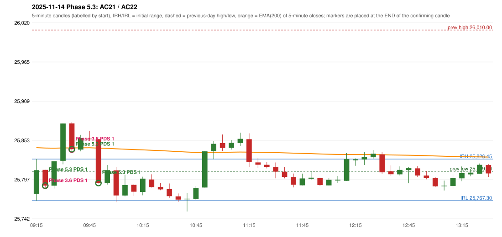

# 2025-11-14 - Phase 5.3 original versus author-corrected signals

> Signal-level comparison only: no controller, no fills, no P&L. Provisional conventions are labelled.

## AC21 (PDF page 4) - topic `NOT_ADDRESSED_BY_THE_CALL`

> The IRF should be activated instead of PDS. | PDS criteria is not satisfying.

* Phase 3.6 automated signal: PDS Method 1 09:25; entry candle OHLC 25811.1/25811.1/25783.55/25788.7
* Phase 3.6 signals to 13:00: 09:25 PDS/Method 1; 09:40 PDS/Method 1; 09:55 IRF/Method 1; 09:55 PDS/Method 1; 10:05 PDS/Method 1; 11:20 IRF/Method 1; 12:35 IRF/Method 1
* Phase 5.3 author-corrected signals to 13:00: 09:25 PDS/Method 1; 09:40 PDS/Method 1; 09:55 PDS/Method 1; 10:05 PDS/Method 1; 10:10 IRF/Method 2A; 11:05 PDS/Method 2; 11:20 PDS/Method 1; 11:25 PDS/Method 2; 11:30 PDS/Method 2; 11:45 IRF/Method 2A; 11:45 IRF/Method 2B
* Reconciliation: **NOT_IN_SCOPE_UNCHANGED** - not addressed by the Phase 5.3 corrections; behaviour unchanged

| measurement | value |
|---|---|
| phase53_signals_to_13_00 | 09:25 PDS/Method 1; 09:40 PDS/Method 1; 09:55 PDS/Method 1; 10:05 PDS/Method 1; 10:10 IRF/Method 2A; 11:05 PDS/Method 2; 11:20 PDS/Method 1; 11:25 PDS/Method 2; 11:30 PDS/Method 2; 11:45 IRF/Method 2A; 11:45 IRF/Method 2B |

## AC22 (PDF page 4) - topic `NOT_ADDRESSED_BY_THE_CALL`

> IRF should activate. | Same day 2nd trade, ig it's glitch.

* Phase 3.6 automated signal: PDS Method 1 09:40; entry candle OHLC 25877.2/25878.95/25835.95/25840.4
* Phase 3.6 signals to 13:00: 09:25 PDS/Method 1; 09:40 PDS/Method 1; 09:55 IRF/Method 1; 09:55 PDS/Method 1; 10:05 PDS/Method 1; 11:20 IRF/Method 1; 12:35 IRF/Method 1
* Phase 5.3 author-corrected signals to 13:00: 09:25 PDS/Method 1; 09:40 PDS/Method 1; 09:55 PDS/Method 1; 10:05 PDS/Method 1; 10:10 IRF/Method 2A; 11:05 PDS/Method 2; 11:20 PDS/Method 1; 11:25 PDS/Method 2; 11:30 PDS/Method 2; 11:45 IRF/Method 2A; 11:45 IRF/Method 2B
* Reconciliation: **NOT_IN_SCOPE_UNCHANGED** - not addressed by the Phase 5.3 corrections; behaviour unchanged

| measurement | value |
|---|---|
| phase53_signals_to_13_00 | 09:25 PDS/Method 1; 09:40 PDS/Method 1; 09:55 PDS/Method 1; 10:05 PDS/Method 1; 10:10 IRF/Method 2A; 11:05 PDS/Method 2; 11:20 PDS/Method 1; 11:25 PDS/Method 2; 11:30 PDS/Method 2; 11:45 IRF/Method 2A; 11:45 IRF/Method 2B |

### Changes in the author-corrected configuration on this date (against Phase 3.6)

| strategy | method | change | Phase 3.6 | Phase 5.3 | cause |
|---|---|---|---|---|---|
| IRF | Method 1 | REMOVED | 09:55 |  | all four Phase 5.3 rules together |
| IRF | Method 1 | REMOVED | 11:20 |  | all four Phase 5.3 rules together |
| IRF | Method 1 | REMOVED | 12:35 |  | all four Phase 5.3 rules together |
| IRF | Method 2A | TIME_SHIFTED_EARLIER | 13:05 | 10:10 | all four Phase 5.3 rules together |
| IRF | Method 2A | ADDED |  | 11:45 | all four Phase 5.3 rules together |
| IRF | Method 2A | ADDED |  | 13:05 | all four Phase 5.3 rules together |
| IRF | Method 2B | ADDED |  | 11:45 | all four Phase 5.3 rules together |
| PDS | Method 1 | ADDED |  | 11:20 | all four Phase 5.3 rules together |
| PDS | Method 1 | ADDED |  | 13:35 | all four Phase 5.3 rules together |
| PDS | Method 2 | ADDED |  | 11:05 | all four Phase 5.3 rules together |
| PDS | Method 2 | ADDED |  | 11:25 | all four Phase 5.3 rules together |
| PDS | Method 2 | ADDED |  | 11:30 | all four Phase 5.3 rules together |

### IRF candidates rejected by the 28-point EMA clearance this date

| method | candle | EMA | relation | range distance |
|---|---|---|---|---|
| Method 2A | 09:55 25854.7/25854.7/25791.85/25792.35 | 25842.03 | EMA_INSIDE_CANDLE | 0.00 |
| Method 2A | 10:00 25792.25/25818.0/25790.2/25810.7 | 25841.72 | EMA_ABOVE_CANDLE | 23.72 |
| Method 2A | 10:05 25810.35/25814.85/25765.0/25774.65 | 25841.05 | EMA_ABOVE_CANDLE | 26.20 |
| Method 2A | 11:20 25854.75/25863.1/25814.95/25821.95 | 25836.32 | EMA_INSIDE_CANDLE | 0.00 |
| Method 2B | 11:20 25854.75/25863.1/25814.95/25821.95 | 25836.32 | EMA_INSIDE_CANDLE | 0.00 |
| Method 2A | 11:25 25821.65/25828.0/25813.95/25818.4 | 25836.14 | EMA_ABOVE_CANDLE | 8.14 |
| Method 2B | 11:25 25821.65/25828.0/25813.95/25818.4 | 25836.14 | EMA_ABOVE_CANDLE | 8.14 |
| Method 2A | 11:30 25818.3/25821.9/25813.15/25815.2 | 25835.93 | EMA_ABOVE_CANDLE | 14.03 |
| Method 2B | 11:30 25818.3/25821.9/25813.15/25815.2 | 25835.93 | EMA_ABOVE_CANDLE | 14.03 |
| Method 2A | 11:35 25815.2/25821.6/25799.1/25808.6 | 25835.66 | EMA_ABOVE_CANDLE | 14.06 |
| Method 2B | 11:35 25815.2/25821.6/25799.1/25808.6 | 25835.66 | EMA_ABOVE_CANDLE | 14.06 |
| Method 2A | 11:40 25808.5/25815.15/25799.05/25801.15 | 25835.31 | EMA_ABOVE_CANDLE | 20.16 |
| Method 2B | 11:40 25808.5/25815.15/25799.05/25801.15 | 25835.31 | EMA_ABOVE_CANDLE | 20.16 |
| Method 2A | 12:40 25808.95/25817.5/25802.5/25804.85 | 25832.31 | EMA_ABOVE_CANDLE | 14.81 |
| Method 2A | 12:55 25813.25/25816.4/25800.9/25803.05 | 25831.62 | EMA_ABOVE_CANDLE | 15.22 |
| Method 2A | 13:00 25803.0/25809.45/25797.7/25799.9 | 25831.31 | EMA_ABOVE_CANDLE | 21.86 |
| Method 1 | 09:55 25854.7/25854.7/25791.85/25792.35 | 25842.03 | EMA_INSIDE_CANDLE | 0.00 |
| Method 1 | 11:20 25854.75/25863.1/25814.95/25821.95 | 25836.32 | EMA_INSIDE_CANDLE | 0.00 |
| Method 1 | 12:35 25833.15/25836.3/25805.6/25807.6 | 25832.59 | EMA_INSIDE_CANDLE | 0.00 |

