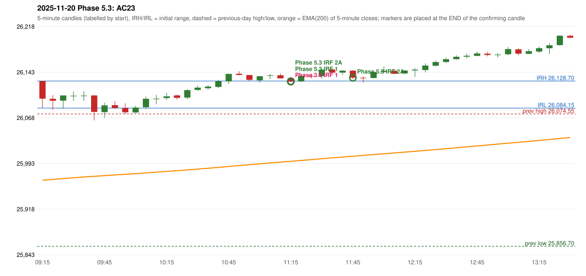

# 2025-11-20 - Phase 5.3 original versus author-corrected signals

> Signal-level comparison only: no controller, no fills, no P&L. Provisional conventions are labelled.

## AC23 (PDF page 4) - topic `NOT_ADDRESSED_BY_THE_CALL`

> [crossed out:] RF should be activated + Or PDR should be activated as it Sab[?]

* Phase 3.6 automated signal: IRF Method 1 11:20; entry candle OHLC 26133.4/26135.95/26126.95/26127.8
* Phase 3.6 signals to 13:00: 11:20 IRF/Method 1; 11:40 IRF/Method 2B
* Phase 5.3 author-corrected signals to 13:00: 11:20 IRF/Method 1; 11:20 IRF/Method 2A; 11:50 IRF/Method 2A
* Reconciliation: **NOT_IN_SCOPE_UNCHANGED** - not addressed by the Phase 5.3 corrections; behaviour unchanged

| measurement | value |
|---|---|
| phase53_signals_to_13_00 | 11:20 IRF/Method 1; 11:20 IRF/Method 2A; 11:50 IRF/Method 2A |

### Changes in the author-corrected configuration on this date (against Phase 3.6)

| strategy | method | change | Phase 3.6 | Phase 5.3 | cause |
|---|---|---|---|---|---|
| IRF | Method 2A | TIME_SHIFTED_EARLIER | 14:30 | 11:20 | all four Phase 5.3 rules together |
| IRF | Method 2A | ADDED |  | 11:50 | all four Phase 5.3 rules together |
| IRF | Method 2B | REMOVED | 11:40 |  | all four Phase 5.3 rules together |

