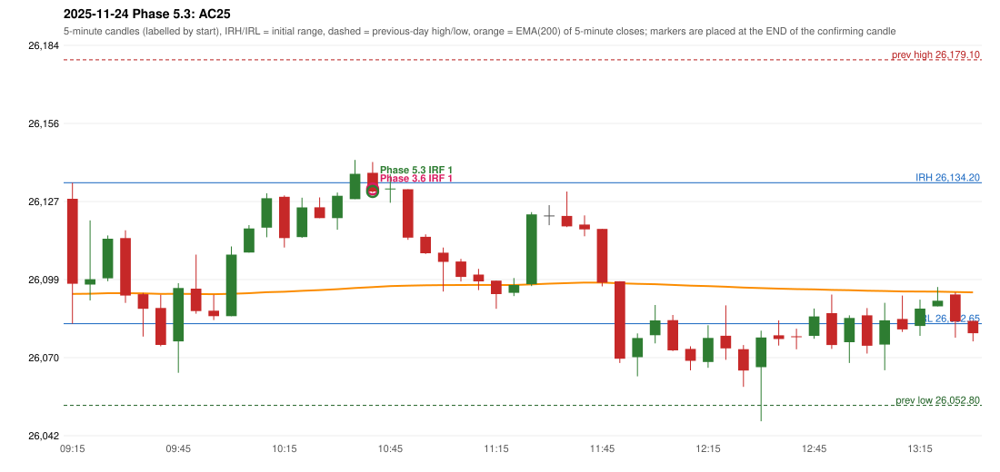

# 2025-11-24 - Phase 5.3 original versus author-corrected signals

> Signal-level comparison only: no controller, no fills, no P&L. Provisional conventions are labelled.

## AC25 (PDF page 5) - topic `NOT_ADDRESSED_BY_THE_CALL`

> RF should be activated, but IRF is entered

* Phase 3.6 automated signal: IRF Method 1 10:45; entry candle OHLC 26137.8/26141.75/26130.5/26130.95
* Phase 3.6 signals to 13:00: 10:45 IRF/Method 1
* Phase 5.3 author-corrected signals to 13:00: 10:45 IRF/Method 1
* Reconciliation: **NOT_IN_SCOPE_UNCHANGED** - not addressed by the Phase 5.3 corrections; behaviour unchanged

| measurement | value |
|---|---|
| phase53_signals_to_13_00 | 10:45 IRF/Method 1 |

### Changes in the author-corrected configuration on this date (against Phase 3.6)

(no signal changes on this date)

