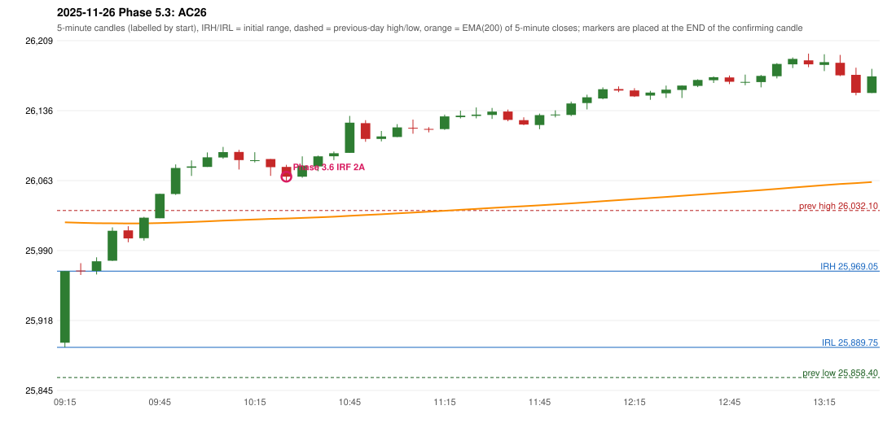

# 2025-11-26 - Phase 5.3 original versus author-corrected signals

> Signal-level comparison only: no controller, no fills, no P&L. Provisional conventions are labelled.

## AC26 (PDF page 5) - topic `IRF_FIRST_RED_CANDLE`

> First red candle should be considered

* Phase 3.6 automated signal: IRF Method 2A 10:30; entry candle OHLC 26077.4/26079.65/26061.9/26067.25
* Phase 3.6 signals to 13:00: 10:30 IRF/Method 2A; 11:40 IRF/Method 2B
* Phase 5.3 author-corrected signals to 13:00: 
* Reconciliation: **APPLIED_NO_OBSERVABLE_EXPECTATION** - the author states only 'first red candle'; Method 2A support is now that candle's LOW; outcome on this date: NO IRF SIGNAL within 13:00

| measurement | value |
|---|---|
| phase53_signals_to_13_00 |  |
| phase53_irf_result_first_red_low | NO IRF SIGNAL within 13:00 |
| phase53_irf_result_red_search_after_breakout | NO IRF SIGNAL within 13:00 |
| first_red_candle | 09:35 |
| first_red_candle_low | 25999.1 |

### Changes in the author-corrected configuration on this date (against Phase 3.6)

| strategy | method | change | Phase 3.6 | Phase 5.3 | cause |
|---|---|---|---|---|---|
| IRF | Method 2A | REMOVED | 10:30 |  | all four Phase 5.3 rules together |
| IRF | Method 2A | REMOVED | 13:30 |  | all four Phase 5.3 rules together |
| IRF | Method 2B | REMOVED | 11:40 |  | all four Phase 5.3 rules together |
| IRF | Method 2B | REMOVED | 13:30 |  | all four Phase 5.3 rules together |
| IRF | Method 2B | REMOVED | 14:20 |  | all four Phase 5.3 rules together |

