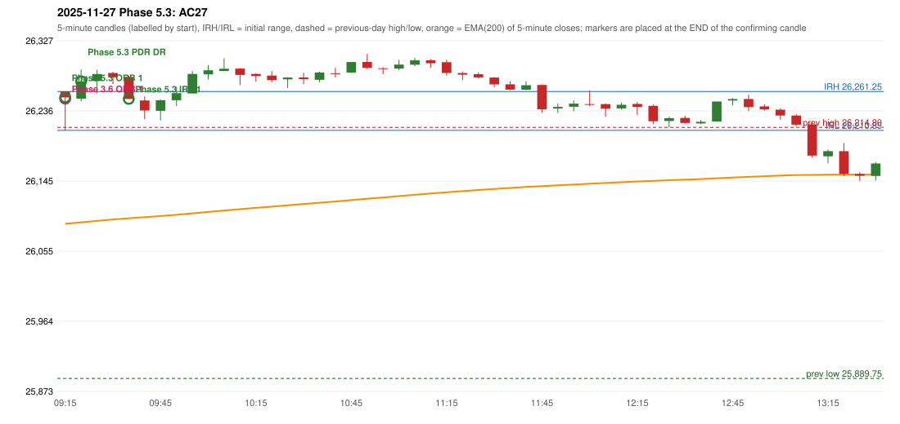

# 2025-11-27 - Phase 5.3 original versus author-corrected signals

> Signal-level comparison only: no controller, no fills, no P&L. Provisional conventions are labelled.

## AC27 (PDF page 5) - topic `ORB_COLOUR`

> ORB is activated on a red candle for long side, which is wrong. ORB for long should be in green closing.

* Phase 3.6 automated signal: ORB Method 1 09:20; entry candle OHLC 26261.25/26261.25/26210.85/26253.6
* Phase 3.6 signals to 13:00: 09:20 ORB/Method 1; 09:40 IRF/Method 1; 10:00 PDR/PDR; 10:15 IRF/Method 2B; 10:45 IRF/Method 2B; 11:25 IRF/Method 2A; 11:50 IRF/Method 1
* Phase 5.3 author-corrected signals to 13:00: 09:20 ORB/Method 1; 09:25 PDR/PDR; 09:40 IRF/Method 1; 10:15 IRF/Method 2B; 10:45 IRF/Method 2B; 11:20 IRF/Method 2A; 11:50 IRF/Method 1
* Reconciliation: **VARIANT_AVAILABLE_NOT_ACTIVE** - ORB colour rule (Phase 5.1) is selectable as phase53-var-orb-colour; not part of the combined configuration

| measurement | value |
|---|---|
| phase53_signals_to_13_00 | 09:20 ORB/Method 1; 09:25 PDR/PDR; 09:40 IRF/Method 1; 10:15 IRF/Method 2B; 10:45 IRF/Method 2B; 11:20 IRF/Method 2A; 11:50 IRF/Method 1 |

### Changes in the author-corrected configuration on this date (against Phase 3.6)

| strategy | method | change | Phase 3.6 | Phase 5.3 | cause |
|---|---|---|---|---|---|
| IRF | Method 2A | TIME_SHIFTED_EARLIER | 11:25 | 11:20 | all four Phase 5.3 rules together |
| PDR | PDR | TIME_SHIFTED_EARLIER | 10:00 | 09:25 | all four Phase 5.3 rules together |
| PDR | PDR | ADDED |  | 14:40 | all four Phase 5.3 rules together |
| PDR | PDR | ADDED |  | 15:20 | all four Phase 5.3 rules together |
| PDR | PDR | ADDED |  | 15:30 | all four Phase 5.3 rules together |

