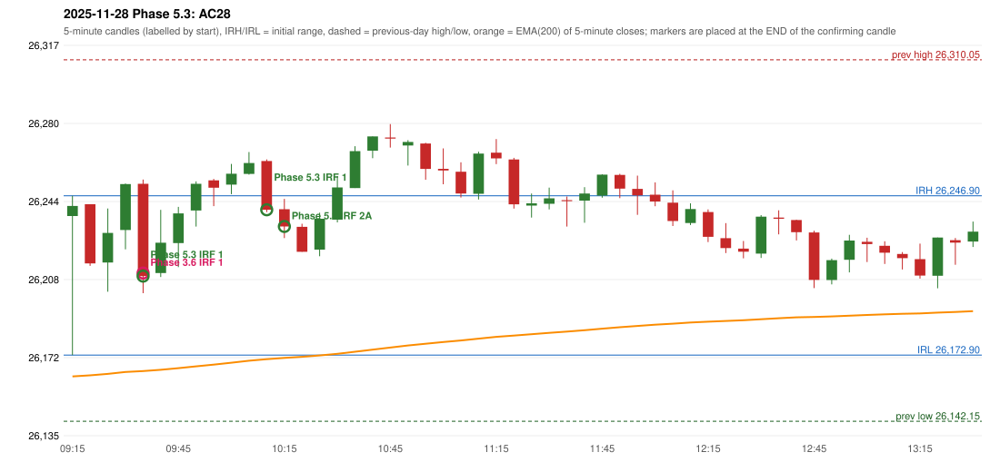

# 2025-11-28 - Phase 5.3 original versus author-corrected signals

> Signal-level comparison only: no controller, no fills, no P&L. Provisional conventions are labelled.

## AC28 (PDF page 5) - topic `ORB_MISSING`

> ORB should be activated instead of IRF

* Phase 3.6 automated signal: IRF Method 1 09:40; entry candle OHLC 26252.45/26254.45/26201.65/26209.55
* Phase 3.6 signals to 13:00: 09:40 IRF/Method 1; 10:15 IRF/Method 1; 11:00 IRF/Method 2B; 11:25 IRF/Method 1; 11:30 IRF/Method 2A; 12:05 IRF/Method 1; 12:10 IRF/Method 2A
* Phase 5.3 author-corrected signals to 13:00: 09:40 IRF/Method 1; 10:15 IRF/Method 1; 10:20 IRF/Method 2A; 11:00 IRF/Method 2A; 11:25 IRF/Method 1; 12:05 IRF/Method 1; 12:10 IRF/Method 2A
* Reconciliation: **UNRESOLVED_MISSING_DEFINITION** - an objective construction of the Method 2 trendline (which fractals, how many touches, slope tolerance) - the source only draws it

| measurement | value |
|---|---|
| phase53_signals_to_13_00 | 09:40 IRF/Method 1; 10:15 IRF/Method 1; 10:20 IRF/Method 2A; 11:00 IRF/Method 2A; 11:25 IRF/Method 1; 12:05 IRF/Method 1; 12:10 IRF/Method 2A |
| orb_cause | METHOD2_TRENDLINE |

### Changes in the author-corrected configuration on this date (against Phase 3.6)

| strategy | method | change | Phase 3.6 | Phase 5.3 | cause |
|---|---|---|---|---|---|
| IRF | Method 2A | TIME_SHIFTED_EARLIER | 11:30 | 10:20 | all four Phase 5.3 rules together |
| IRF | Method 2A | TIME_SHIFTED_EARLIER | 12:10 | 11:00 | all four Phase 5.3 rules together |
| IRF | Method 2A | ADDED |  | 12:10 | all four Phase 5.3 rules together |
| IRF | Method 2B | REMOVED | 11:00 |  | all four Phase 5.3 rules together |

